<div align="center">

# RIDGE RACER TYPE 4 · RAGE RACER · RIDGE RACER (1994)

**Three Namco PlayStation racers, one self-hosted arcade cabinet — in the browser, on the LAN, and natively on Windows.**

</div>

The cabinet is one Node process, plus a small socket relay for netplay. It serves
the discs, the BIOS, the soundtrack and a self-hosted EmulatorJS front end, so
every player runs their own **PCSX-Rearmed** core inside the page. On top of the
emulator the cabinet adds a persistent soundtrack shell, a 2P lounge (real
split-screen VS Battle on Type 4, a shared car plus turn-based ghost on Rage
Racer and Ridge Racer 1994) and **Race Day**: one 50-driver mass start on one
shared clock.

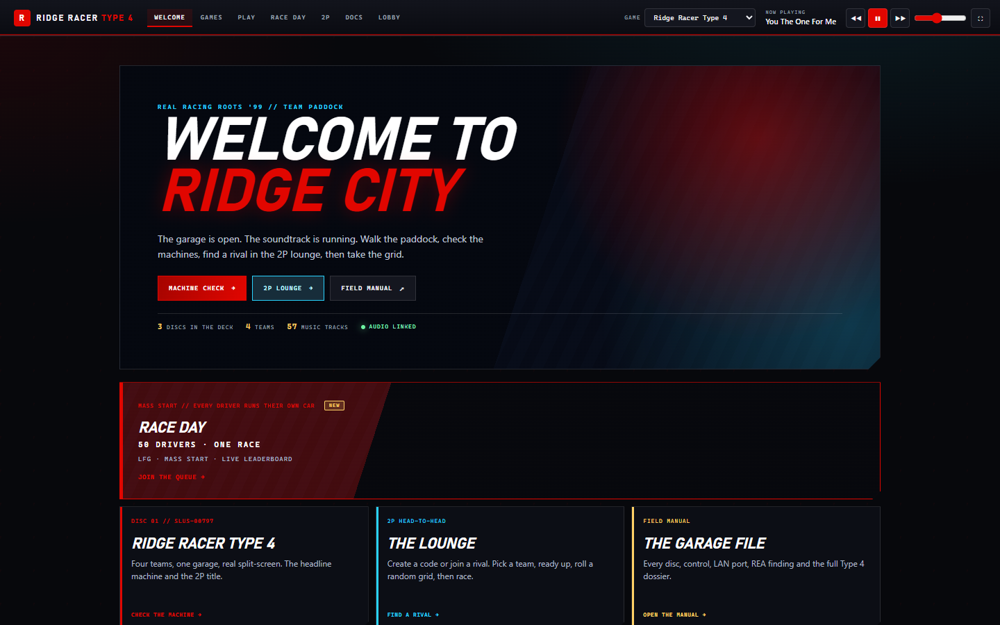

*After ENTER, the hub and the soundtrack player share one top bar. The player
follows the selected disc and keeps playing while you browse the manual.*

## Quick start

```powershell
git clone <repo-url>
cd <repo>\_server
npm install
.\start-test.bat          # web server only: /play, 2P lounge, Race Day
```

Open **<http://localhost:8080/>** on the host, or
**`http://<host-lan-ip>:8080/`** on any device on the same network. The disc
images and BIOS are user-supplied — see [Games](#games) and
[`_server/README.md`](_server/README.md). In the commands on this page,
`<repo>` is the directory you cloned into and `<host-lan-ip>` is the address
printed by the server banner.

| Route | What it is |
|---|---|
| `/` | The cabinet shell: ENTER gate, parent-owned audio, iframe views |
| `/play` | Browser disc deck + game (EmulatorJS 4.2.3) |
| `/play-net` | LAN netplay page; R4 VS Battle, Rage/Ridge shared car + ghost |
| `/multiplayer` | 2P lounge: room code, DISC/DRIVE/TURN, teams, READY |
| `/race-day` | Race Day: grid, LFG, live standings, results (up to 50 drivers) |
| `/music`, `/api/music` | Soundtrack player and generated manifest |
| `/lobby` | Legacy lobby and native host-stream fallback |
| `/docs` | The field manual (Zudoku, built from `docs/`) |

| 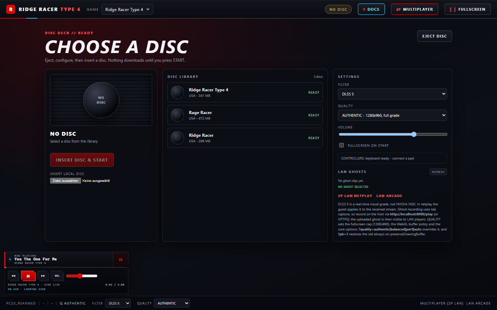 | 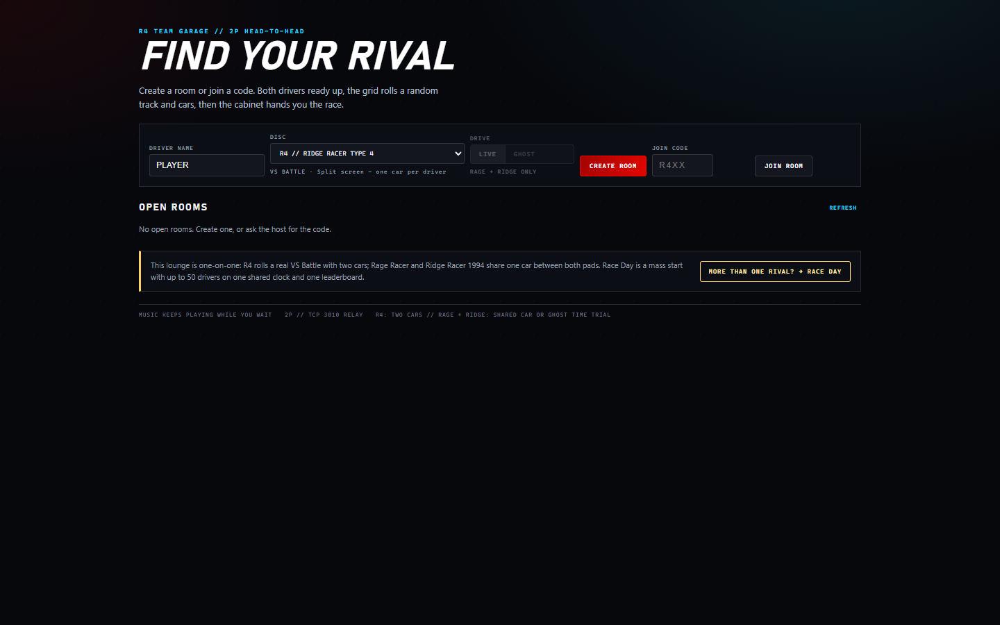 |
|---|---|
| **`/play`** — the disc deck with FILTER/QUALITY/VOLUME and the soundtrack player bottom-left. | **`/multiplayer`** — DISC, DRIVE, TURN, room code; the race starts when both seats are READY. |
| 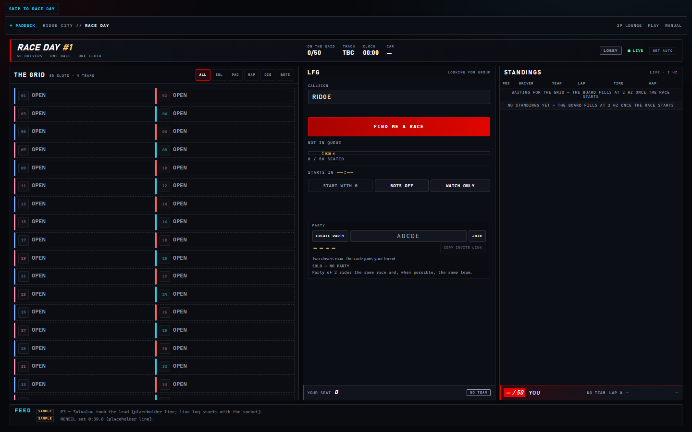 | 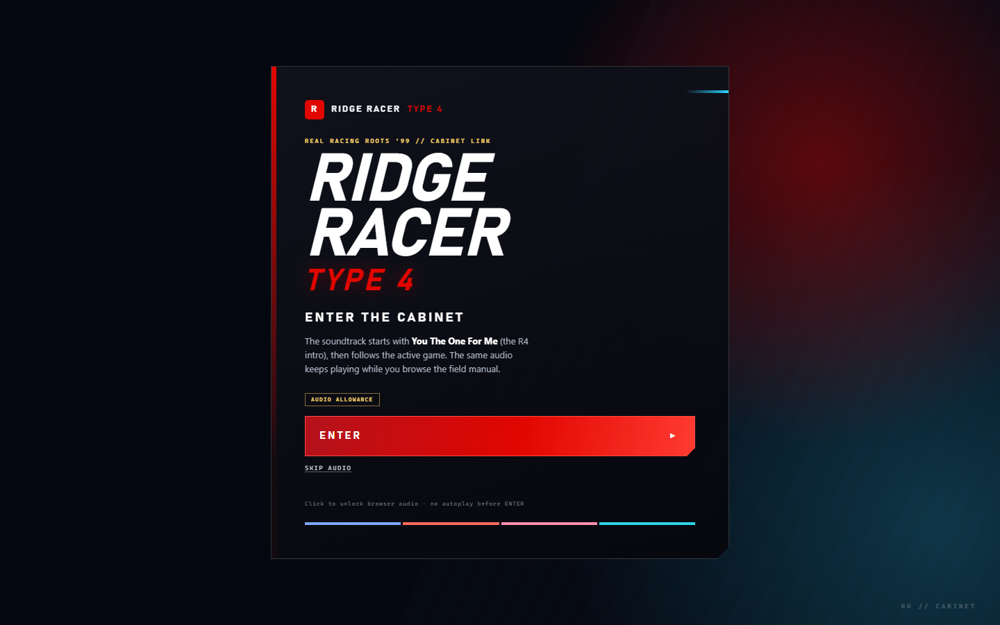 |
| **`/race-day`** — 50-slot grid, LFG queue, live standings. | **`/`** — the ENTER gate; the click is the audio gesture, and a refresh returns here. |

| 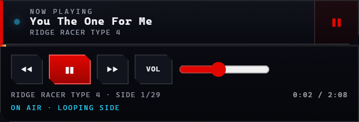 |
|---|
| **Soundtrack player** — one `HTMLAudioElement` owned by the parent shell; it follows the GAME selector and ducks to ~22% while a game view is active. |

<sub>**Scan to play:**  — the checked-in QR targets `http://localhost:8080/play`; regenerate it for your LAN with `node make-qr.mjs` from `_server`.</sub>

The games run **inside the browser canvas**. A self-hosted
[EmulatorJS](https://emulatorjs.org/) front end boots the PlayStation core
(PCSX-Rearmed, WebAssembly) in the page. Gameplay needs **no host video stream
and no ffmpeg**: the host serves the compressed disc image, BIOS, music and
EmulatorJS assets over the LAN, and each browser renders its own game.

The same Express process also serves the built **Zudoku field manual** at
`/docs` and the extracted **soundtrack player** at `/music`.

## Games

| Game | Disc | Mode | Notes |
|---|---|---|---|
| **Ridge Racer Type 4** (USA) | `r4.chd` — 341 MB | 1–2P split-screen | The 2P LAN headline title — the only disc with a real two-car VS Battle. Serial `SLUS-00797`. |
| **Rage Racer** (USA) | `rage-racer.chd` — 472 MB (495,297,808 bytes) | 1P disc / 2P **shared car** | 4 courses run forward/reverse; the disc has 17 CD tracks. In the lounge both pads drive one car. Serial `SLUS-00403`. |
| **Ridge Racer** (1994, USA) | `ridge-racer.chd` — 296 MB | 1P disc / 2P **shared car** | 1 seaside course; the disc has 14 CD tracks. In the lounge both pads drive one car. Serial `SCUS-94300`. |

Use the **GAME** selector on `/play`, or open directly:

- Type 4: <http://localhost:8080/play?game=r4>
- Rage Racer: <http://localhost:8080/play?game=rage>
- Ridge Racer (1994): <http://localhost:8080/play?game=ridge>

Only **Ridge Racer Type 4** has a real two-car race (split screen, VS Battle).
**Rage Racer** and **Ridge Racer (1994)** are single-player discs: the 2P LOUNGE
runs them as a **shared car** — the host starts a normal single-player race by
hand and the guest pad is merged onto the host's car, with no split screen and
no automatic menu macro — or as a turn-based **GHOST**: the finished run becomes
the other seat's ghost, drawn live on track on Ridge's race screen and in Rage
Grand Prix and replayed full screen afterwards (Rage Time Attack is replay-only).
The lounge has a **DISC** selector for all three;
details: <a href="/docs/multiplayer/shared-car">/docs/multiplayer/shared-car</a>.

## Documentation

The field manual is a Zudoku site built from `docs/` and served by the cabinet:

- <http://localhost:8080/docs>
- <http://localhost:8080/docs>

It covers the three games, the browser/native/host-stream play paths, LAN 2P,
controls, troubleshooting, architecture and the REA evidence. Rebuild it after
changing a page or theme:

```powershell
cd docs
npm install          # once
npm run build        # outputs docs\dist\docs
```

`docs\README.md` documents the site itself. The root `AGENTS.md` is the
documentation contract: behaviour changes must update the relevant docs in the
same change.

## Music player

The default page **`/`** is an **ENTER THE CABINET** login shell. The first click
gives the browser the audio gesture it requires and starts the Ridge Racer Type 4
intro song **"You The One For Me"**. The first view is **WELCOME TO RIDGE CITY**
(`/welcome`), the garage/paddock hub. From there you can roam to **GAMES**
(machine check), the **2P LOUNGE** (`/multiplayer`), **RACE DAY** (`/race-day`,
the 50-driver mass start), or the **FIELD MANUAL** (`/docs/introduction`); no
game starts until you choose **START** or **CHECK DISC DECK**. The shell bar adds
**PLAY**, **RACE DAY**, **DOCS** and **LOBBY** (`/lobby`), which load inside the
shell's iframe, so the soundtrack keeps playing while you inspect the field
manual. Every refresh returns to **ENTER**; the gate is never
skipped. The old lobby lives at `/lobby`.

The 2P lounge creates/joins 4-character rooms, assigns the four R4 teams, and
starts only when **both** players are READY. A **DISC** selector on the start
card picks `r4`, `rage` or `ridge`; the host can change it in the room until the
grid locks, and the guest follows the room's disc. The server rolls the course
and a car from that disc's manifest (`/mp-games.json`) and sends the same plan to
both browsers. Rage/Ridge rooms also offer **DRIVE LIVE | GHOST**: GHOST is a
turn-based mode where the run you finish becomes the other player's ghost — drawn
on track while you race (Ridge race screen + Rage Grand Prix) and replayed full
screen afterwards. Details and the current evidence are in **2P LAN** below.

- The player follows the **GAME** selector: `r4`, `rage`, or `ridge` switches the
  playlist and the whole page theme.
- Audio is extracted from the user's own discs into
  `_server/public/music/<game>/` as 192 kbps MP3.
- The manifest is generated from the per-game `tracks.json` files:

  ```powershell
  cd _server
  node scripts/build-music-manifest.mjs
  ```

- The player is served by `/music/` and the manifest by `/api/music`
  (also `/music/manifest.json`).
- R4 has no CDDA tracks; its intro, ending and 27 in-game XA cues are extracted
  from `R4.STR`. Rage Racer contributes 16 CD tracks and Ridge Racer 12.

The audio is for local LAN play only. It is not redistributed as part of the
code; it is extracted from the user's legally obtained discs.

## 2P LAN (R4 VS Battle, Rage/Ridge shared car + ghost)

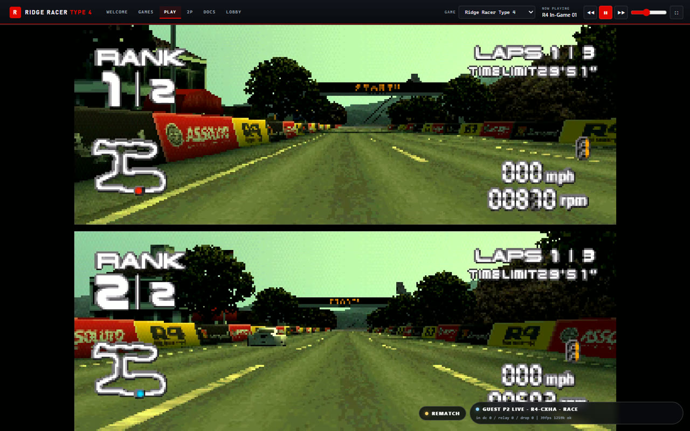

Both players open `/`, press ENTER, and choose **2P LOUNGE** (`/multiplayer`).
One creates a room, the other joins with the 4-character code, each picks a
driver name and one of the four teams, and the race starts only once both are
READY. A **DISC** selector on the start card picks the title for the room:

| Disc | `game=` | 2P mode | Server plan | Host start |
|---|---|---|---|---|
| Ridge Racer Type 4 (id 4) | `r4` | **VS BATTLE** — split screen, one car per driver | 8 courses in in-game menu order, 8 preset cars (`D1–D4`, `G1–G4`) | automatic macro |
| Rage Racer (id 5) | `rage` | **SHARED CAR** - one car, both pads drive it (or **GHOST**: live in Grand Prix, replay in Time Attack) | 4 courses (Mythical Coast, Over Pass City, Lakeside Gate, The Extreme Oval), `CAR 1-4` | manual: host starts a single-player race |
| Ridge Racer 1994 (id 6) | `ridge` | **SHARED CAR** — one car, both pads drive it (or **GHOST**: live on the race screen + replay) | 1 course (Seaside Route 765), `Solvalou`/`Mappy`/`Bosconian`/`Nebulasray` | manual: host starts a single-player race |

- The disc list lives in **one file**, `_server/public/mp-games.json` (served at
  `/mp-games.json`). The host creates the room with its disc; the guest joins by
  code and adopts the room's disc. Only the host may change the disc — the room
  card's **HOST // CHANGE DISC** selector — and only before the grid locks.
  `?game=rage|ridge` preselects it and the choice is remembered in the browser.
- For R4 the server rolls **one of the eight R4 courses in in-game menu order**
  (Helter Skelter, Wonderhill, Edge of the Earth, Out of Blue, Phantomile,
  Brightest Nite, Heaven and Hell, Shooting Hoops) and a **preset car per
  driver** (`D1–D4`, `G1–G4`). Rage and Ridge roll from their own shorter lists.
  Both browsers receive the same plan.
- The shell hands each browser to

  ```text
  /play-net?embedded=1&threads=0&mpRole=host|guest&mpRoom=<code>&mpRace=<raceId>
            &mpTrackIndex=<r4 0-7 | rage 0-3 | ridge 0>&mpCarHost=<0-7|0-3>&mpCarGuest=<0-7|0-3>
            &game=r4|rage|ridge[&mpGhost=ghost&mpTurn=host|guest]
  ```

- `_server/public/js/play-net.js` auto-hosts the relay room with the manifest's
  prefix — `R4-<code>`, `RAGE-<code>` or `RIDGE-<code>` — and password
  `raceId` (retry loop, visible stage log); the guest retries the relay's
  `/list` until that exact room exists and joins it.
- **R4 host macro (unchanged):** the host reads R4's main-menu selection byte
  `0x800AC801` (label table `0x800A2180`) to confirm it is on the main menu, then
  walks Down ×2 → VS BATTLE → car P1 (`Right` × `mpCarHost` for `D1–G4`) → car
  data → AT/MT → AT → car P2 (player index 1, `Right` × `mpCarGuest`) → course
  (`Right` × `mpTrackIndex`, wraps at 8) → Circle.
- **Rage Racer / Ridge Racer 1994 are shared car.** There is no split screen and
  no second car: the host starts a normal single-player race by hand (**no**
  automatic macro), and the host merges the guest pad onto its own car
  (player 1 → player 0) so both pads drive it. The guest is live from boot in
  this mode (no `race-live` lock); the netplay panel stage reads `MANUAL`, the
  chip shows `GUEST P2 SHARED` until the guest joins and then
  `GUEST P2 LIVE`, and the page brand says `2P SHARED` (R4 stays `2P VS`). How
  to start it, and what is *not* claimed:
  <a href="/docs/multiplayer/shared-car">/docs/multiplayer/shared-car</a>.
- **GHOST mode (Rage/Ridge only) is turn-based, with a live ghost on track.**
  The start card has a `DRIVE LIVE | GHOST` control, disabled for
  R4 with the hint `RAGE + RIDGE ONLY`; the choice persists in the browser
  (`localStorage['rr4.mp.drive']`). In a ghost room the card reads
  `DRIVE GHOST // TURN-BASED TIME TRIAL`, and the **host alone** — only before
  the grid locks — picks `TURN HOST | GUEST`, i.e. who drives this run. Both
  seats then see `DRIVER: HOST` / `DRIVER: GUEST` instead of
  `SHARED CAR // BOTH PADS DRIVE`, the rooms list marks the room `GHOST`, and
  the invite link carries `drive`/`turn`.
- **What ghost actually does:** one driver drives; the other seat's pad is gated
  on the host core. Two doors ship:
  1. **Live ghost** (`mpLiveGhost=1`, appended by the shell/standalone for every
     ghost room — the default; `0` opts out). The rival tape is applied to a
     spare rival car slot every frame and **drawn by the game** while you race:
     **Ridge Racer 1994's race screen** and **Rage Racer Grand Prix** only. It is
     drawn, not simulated — no collision, no AI. Rage **Time Attack** never draws
     the rival slots and stays replay-only (`GHOST // REPLAY
     (draw-path-unverified)`).
  2. **Post-race replay** (`ghost replay (sequential)`): the game's own results
     screen plays the other seat's tape full screen (Ridge Racer: `WATCH RIVAL`
     arms the built-in replay; Rage Racer: the race's own finish branch hands over
     to the replay scene).
  Two runs (one per seat) give both players a ghost, and a
  **REMATCH flips the turn** in the same room on the same disc.
- **Handoff** adds `&mpGhost=ghost&mpTurn=host|guest&mpLiveGhost=1` in ghost rooms
  (`live` rooms send `mpGhost=live` and no `mpTurn`/`mpLiveGhost`). The shell
  always emits `mpGhost`, so an R4 handoff from the shell reads
  `&game=r4&mpGhost=live` with no `mpTurn`; the standalone `/multiplayer` page
  omits `mpGhost` for R4. Either way `play-net.js` treats absent/`live` as off, so
  the VS Battle path is unchanged.
- **Honest ghost limits:** the harness tapes are synthetic short runs (Ridge 161
  records, Rage 100 subframes / 50 samples), no human lap has been recorded, and
  Rage TA is replay-only. The live ghost is host-only evidence, scoped to Ridge's
  race screen and Rage Grand Prix, and is a **drawn pose** — never read it as a
  second physics car, a collision or "two cars on track" on Rage Time Attack.
- **REMATCH** is one click per seat: on each tab, the chip next to the netplay
  status chip reloads the lounge (`?room=<code>&host=1|0&game=<disc>`) for the
  same room and the same disc — a ghost room adds `&drive=ghost&turn=<opposite>`
  so the turn flips. The host recreates that code; the guest retries until it
  exists. Both press READY for a fresh server plan.
- **R4 guest gate:** the guest core is frozen and guest input is **gated** until
  the host signals `race-live` over the netplay data channel, so an early pad
  press cannot move the host's car-select cursor; the host also broadcasts stage
  and plan updates into the guest's log and chip. A manual `/play-net` join (no
  lounge `mpRole`/`mpRoom`) is not gated, because no host macro runs. On
  Rage/Ridge (shared car) there is no macro, so the guest is live from boot.
- **Stream:** the host captures its canvas at **60 fps**
  (`captureStream(0)` + `requestFrame()` per core frame) with an 8 Mbps cap,
  forces a keyframe on `race-live`/join/freeze, and sends guest input **once**
  (the extra Socket.IO copy is suppressed while the data channel is open).
  Measured host encode 59.08 fps, guest decoded 57.44 fps, 0.9–2.5 Mbps, 0 %
  loss, 0–1 ms RTT. The guest *presented* frame rate is 42–55 fps, so do not
  claim a solid 60. The netplay panel's **QUALITY** selector (AUTO/LOW/MED/HIGH
  = 1.5 Mbps/30, 4/60, 8/60) is sent to the host; a 2 s `getStats()` line shows
  in the stage log and `window.__R4NET.stats`.
- **Guest audio is absent, not just unverified.** The 4.3 host captures from
  `Module.AL.currentCtx`, which is `null` under RWebAudio, so the stream carries
  video only (`No audio tracks captured - guests will have no audio`). The guest
  hears the game only through the host's speakers.
- Calibrated **R4** course order (one `Right` per index, wraps after index 7) and
  car order (`Right` from the default `D1`) are recorded as screenshots in
  `_runtime/calib/`. Rage/Ridge have no automatic macro, so no menu addresses or
  calibration tables are claimed for them.
- **Honest limits:** R4's two-car VS Battle is the only harness-verified
  **simultaneous** 2P mode. Rage Racer and Ridge Racer 1994 use a shared car in
  the lounge and are `netplay transport; in-game mode unverified` — the lobby
  plan, the disc handoff and the input remap exist, but no harness has yet proved
  a live Rage/Ridge race, so do not read this section as "Rage/Ridge 2P works".
  Their **GHOST** mode is harness-verified under two scoped labels:
  `ghost replay (sequential)` (40/40 engine + 36/36 lounge) for the post-race
  native replay, and `ghost rendered (in-game)` (36/36 live ghost) for the car
  drawn on **Ridge's race screen** and in **Rage Grand Prix** only. The live ghost
  is drawn, not simulated, and **Rage Time Attack is replay-only**.

The standalone `/multiplayer` page (opened outside the shell) hands off with the
same full plan as the shell since 2026-11-05/06: `mpTrackIndex`, `mpCarHost`,
`mpCarGuest` and `game` are appended from the server's `race` message, so
`/play-net` never rerolls. The shell's **2P LOUNGE** is still the supported entry
path.

The `/mp` lobby transport has a 20 s heartbeat that terminates dead sockets,
host promotion when the host dies, room-list broadcasts, a `ping` →
`{type:'pong'}` message and a 5-minute stale-room sweep. The long-running `:8080`
process was restarted on 2026-11-06 and now serves the heartbeat build;
`mp-ws-probe.mjs` observes the app-level `pong` and a server heartbeat ping
against it. If the running cabinet predates the multi-disc lounge, its `room`
frame has no `game`/`mode` and `/mp-games.json` is cached for an hour — restart
it (`_server\start-test.bat`) before testing the DISC selector by hand.

### 2P verification (checked-in harnesses)

```powershell
cd _server
node test-mp-lobby-ui.mjs    # two-browser lounge UI + handoff -> _runtime/mp-lobby-ui.json
node mp-ws-probe.mjs         # raw /mp WebSocket transport  -> _runtime/mp-lobby-ws.json
node mp-games-probe.mjs      # multi-disc /mp + manifest    -> _runtime/mp-games.json
node test-mp-games-ui.mjs    # multi-disc lounge UI         -> _runtime/mp-games-ui.json
node test-mp-shared-car.mjs  # Rage host manual + remap     -> _runtime/mp-shared-car.json
node test-mp-live-ghost.mjs  # live ghost: RAM stub + patch, A/B  -> _runtime/mp-live-ghost.json
node test-mp-ghost-replay.mjs # ghost engine: Ridge tape swap, Rage arm -> _runtime/mp-ghost-replay.json
node test-mp-ghost-lobby.mjs  # ghost lounge UI + rematch turn flip -> _runtime/mp-ghost-lobby.json
node mp-macro-test.mjs       # host-only R4 VS Battle macro -> _runtime/mp-macro-evidence.json
node test-mp-race-e2e.mjs    # two-browser race, guest P2  -> _runtime/mp-race-e2e.json
node mp-heartbeat-probe.mjs 8095   # 10/10: heartbeat/stale rooms on a throwaway port
```

Labels as of this session:

| Check | Label |
|---|---|
| Two-browser lounge UI + identical `/play-net` `mp*` URL | `harness-verified` — 33/33 (`_runtime/mp-lobby-ui.json`) |
| Multi-disc lounge transport + manifest (`/mp-games.json`, per-disc rolls, host-only `setgame`, guest adoption) | `harness-verified` — 16/16 (`_runtime/mp-games.json`) |
| Multi-disc lounge UI: RAGE/RIDGE create/join/disc change/READY, handoff `game=`, R4 regression | `harness-verified` - 32/32 (`_runtime/mp-games-ui.json` + `mp-games-*.png`); `/play-net` held, so no emulator boot |
| Rage shared-car host path: real Rage core, manual stage, `player 1 → 0` remap install | `harness-verified host-only` - 14/14 (`_runtime/mp-shared-car.json`); one browser, no guest, no live drive |
| Ghost replay engine: Ridge 161-record tape staged + played back, Rage finish arm → scene 17, turn gate, IndexedDB | `harness-verified ghost replay (sequential)` — 40/40 (`_runtime/mp-ghost-replay.json` + `mp-ghost-*.png`); host-only, synthetic tapes |
| Live ghost (Route B): RAM stub + one repointed word, ghost slot pose == tape 16/16 on Ridge's race screen and Rage Grand Prix, A/B delta, flag matrix | `harness-verified ghost rendered (in-game)` — 36/36 (`_runtime/mp-live-ghost.json` + `mp-live-ghost-{rage,ridge}-{off,on}.png`, `mp-live-ghost-a-replay.png`); host-only, synthetic tapes, **drawn not simulated**, Rage TA replay-only |
| Ghost lounge: DRIVE/TURN selectors, `mpGhost`/`mpTurn`/`mpLiveGhost` handoff, `DRIVER:` overlay, rematch turn flip | `harness-verified` — 36/36 (`_runtime/mp-ghost-lobby.json` + `mp-ghost-lobby-*.png`); two browsers, `/play-net` held so no core boots |
| Raw `/mp` lobby WebSocket | `harness-verified` — 22/22 (`_runtime/mp-lobby-ws.json`); app-level `pong` and a server heartbeat ping observed on the restarted `:8080` |
| `/mp` heartbeat, host promotion, stale-room sweep (throwaway `:8095`) | `harness-verified` — 10/10, console only |
| Host VS Battle macro, real R4, reaches `race:live` | `harness-verified host-only` — 6/6 (`_runtime/mp-macro-evidence.json`, `_runtime/mp-macro-final.png`, `_runtime/mp-macro-0*.png`) |
| Shell fullscreen, `F` from inside the frame, no second audio gate, ducking, embedded fill | `harness-verified` — 30/30 (`_runtime/shell-fs.json`, `_runtime/shell-fs-*.png`) |
| Two-browser race with the guest driving P2 (R4 only) | `harness-verified two-browser` — 40/40 (`_runtime/mp-race-e2e.json` + `_runtime/mp-race-e2e-*.png`); two browser contexts on one host; the guest chip flips to `GUEST P2 LIVE` |
| Rage Racer / Ridge Racer 1994 in-game shared-car drive | `netplay transport; in-game mode unverified` — no race harness yet |

Run the 2P set in one table: `cd _server; node verify-mp.mjs` (fast) or `node verify-mp.mjs --full` (adds the race); the three ghost suites are separate commands. The two multi-disc suites spawn their own throwaway cabinets (`:8097` and `:8093`). The ghost harnesses do the same — `test-mp-ghost-replay.mjs` spawns its own cabinet on `:8096` (walks to the next free port) and drives one real `/play-net` page at a time, `test-mp-live-ghost.mjs` spawns its own `:8088` (walks; one real host core per disc) and re-probes `:8080` at the end, and `test-mp-ghost-lobby.mjs` spawns and kills its own `:8093`; none of them touches `:8080`.

## Race Day (one race, up to 50 drivers)

Race Day is the third room: **one race, one shared clock, one leaderboard**.
Every driver boots R4 in their own browser, so nobody streams video and the
server owns only the event — the course, the car class, the start signal, the
seats and the live standings.

1. Open `/`, press **ENTER**, then **RACE DAY** in the top bar (or go straight to
   `/race-day`). It is also the primary card on `/welcome`; `/games` has the same
   CTA, R4 only (Rage Racer and Ridge Racer 1994 show it disabled with the
   reason).
2. Type a callsign and press **FIND ME A RACE**. The LFG panel is the only thing
   that starts a human race: it shows queue position, the fill meter, the ETA
   and a **START NOW** button once 4 drivers are queued (labelled
   "START WITH n"; with bots on, one queued driver is enough).
3. Bring a second driver with the invite link **`/race-day?party=CODE`**
   (**COPY LINK** in the LFG panel). A party is two drivers and gets the same
   team when a seat is free.
4. The server rolls **one of the eight R4 courses** in in-game menu order and a
   `D` or `G` car class, freezes the grid for 5 s, then runs a 3-2-1 countdown
   with a fixed `startsAt`. From then on every driver has the same race and the
   same clock; the standings are derived from telemetry (lap desc, then elapsed
   time), never from a client-claimed position.
5. Your in-race view is `/play?mmo=1&event=<id>&seat=<n>&team=<t>`
   (add `&game=r4&threads=0`): R4 runs locally with the Race Day HUD — position
   `P7 / 50`, lap/time/best, gap chips, a top-5 board and a **FINISHED** card
   that links back to `/race-day`. Nothing navigates for you yet: the page shows
   the grid, countdown, live standings and results, and your seat row gives the
   `seat`/`team` values the HUD URL needs.
6. To watch, open **`/race-day?spectate=1`**: a standings-only board with no
   seat, no telemetry and no video.
7. To demo a full grid with one human, open **`/race-day?bots=1`** (or start the
   server with `RR4_MMO_BOTS=1`). Every bot is labelled `BOT` — a bot race is a
   demo, never a player race.

### Screens

| Lobby — 37/50, LFG queue | GRID LOCKED — 50/50 |
|---|---|
| 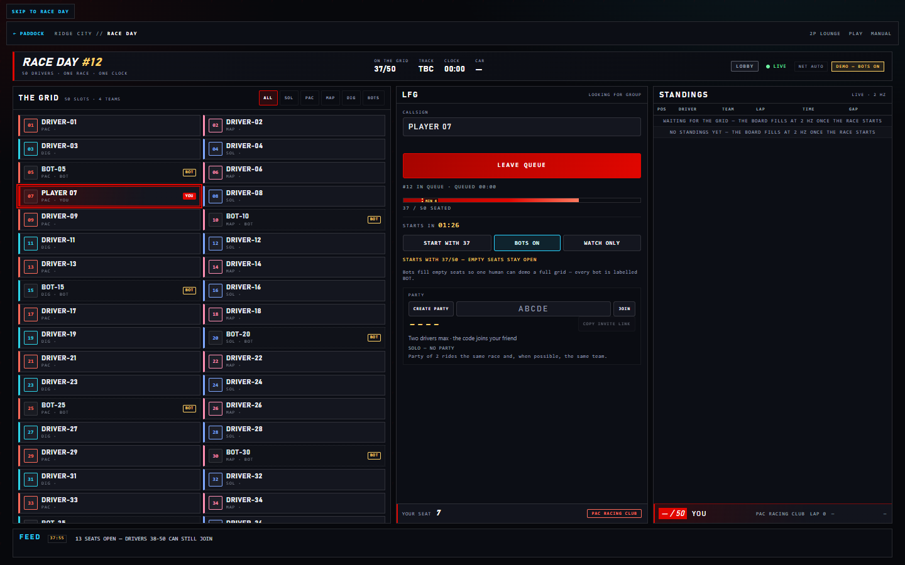 | 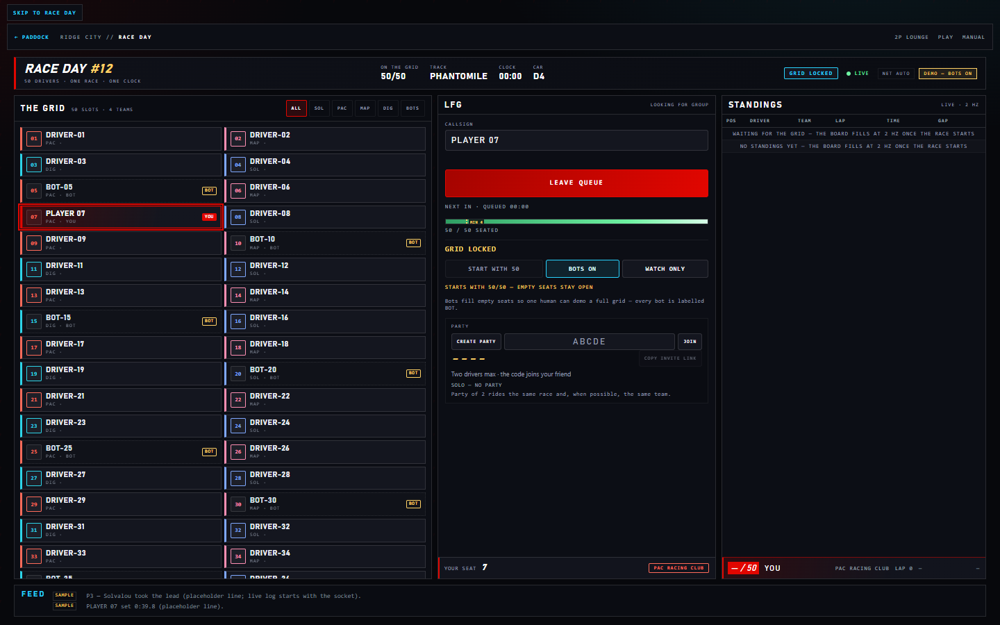 |
| **Live standings — top 10 + you** | **In-race HUD on `/play?mmo=1`** |
| 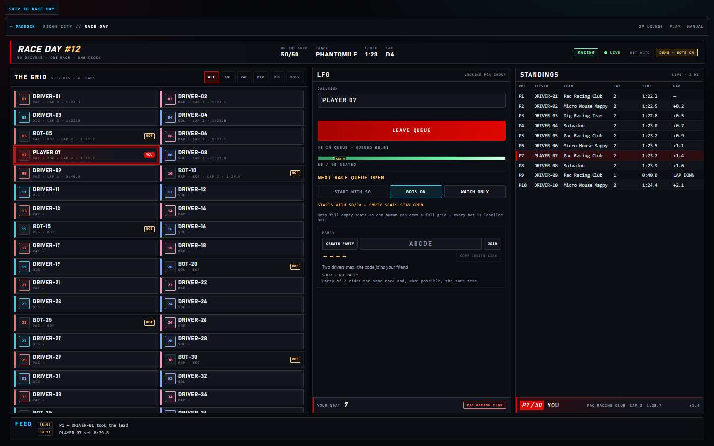 | 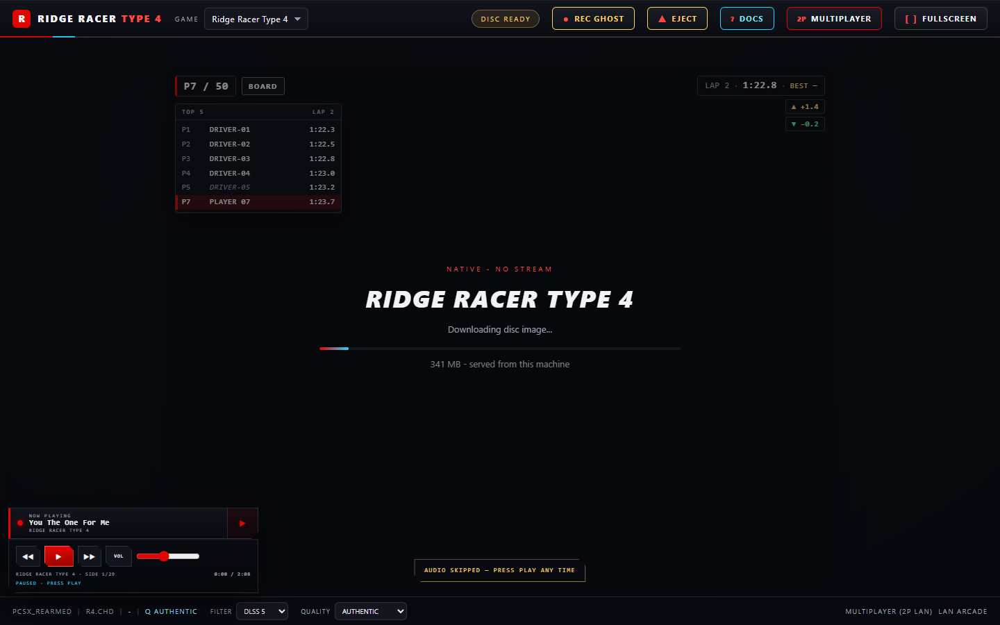 |
| **Results — 50 rows + podium** | **Spectating on a phone** |
| 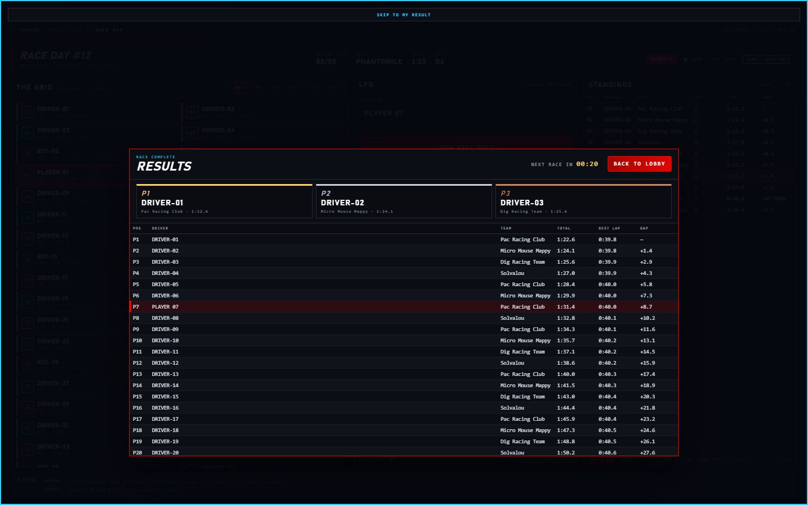 | 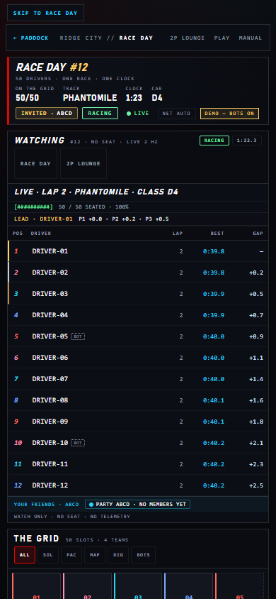 |

Also captured: the `/welcome` hub card, the room inside the shell iframe, a party
code with its invite link, and the 390×844 lobby
(`_server/public/img/race-day/race-day-{hub,shell,party,lobby-mobile}.png`).
The originals for every state at both sizes are in
`_runtime/mmo-shot-*.png`; regenerate with `node mmo-shots.mjs`.
These are UI captures with injected `/mmo` frames, **not** a 50-human race.

Honest scale: **50 seats is the MVP target**. The server was load-probed with
**550 synthetic WebSocket clients** (`RR4_MMO_MAX=550`): 550 sockets / 550
seats, 0 dropped, standings at 1.93–1.95 Hz, broadcast p95 527–528 ms (p99
531), grid ≤1,973 B, standings ≤1,290 B, ~1.1–1.4 MB/s total egress. That is
**not** 550 humans and not 550 browser cores. There are **no ghost cars in Race
Day**, no
spectator video and **no persistence** (restarting the server starts a new race
day); telemetry is reported by each browser from PSX RAM and clamped
server-side. The race clock (`0x800F4E2F`, mirror `0x8010C24F`) and speed
(`0x800AC0EE`, 8.8 fixed, km/h = raw / 64) are RE-confirmed; the **lap counter
is still unconfirmed**, so the HUD shows the board's lap for you and falls back
to a time estimate, and the in-game clock pins at `9:59.999`.

| Check | Label |
|---|---|
| `/mmo` protocol: hello/welcome, seats + team balance, start-now lifecycle, one plan for every client, telemetry ordering, clamps, ~2 Hz standings, finish→result→lobby, heartbeat, seat reclaim, `/api/mmo/status`, 60-client fanout | `harness-verified` — 12/12 (`_runtime/mmo-protocol.json`) |
| Race Day UX, two browsers: ENTER → RACE DAY → LFG → countdown → standings → results, party invite, spectate, `/play?mmo=1` HUD | `harness-verified two-browser` — 41/41 (`_runtime/mmo-e2e.json` + `mmo-e2e-*.png`); the ROM request is held, so no emulator boot |
| Desktop 1440×900 + mobile 390×844 screenshots for lobby, LFG, grid, countdown, standings, HUD, results, spectate, shell entry | 24/24 captures (`_runtime/mmo-shots.json`, `mmo-shot-*.png`) |
| 550-seat fan-out | `harness-verified synthetic load` — 550 sockets / 550 seats, 0 dropped (`_runtime/mmo-load-550-single.json`, `_runtime/mmo-load.json`); synthetic clients, not humans |

```powershell
cd _server
node mmo-protocol-test.mjs              # 12/12 -> _runtime/mmo-protocol.json
node test-mmo-ui.mjs                    # 41/41 two-browser (spawns its own :8093)
node mmo-shots.mjs                      # 24/24 captures (:8080, or RR4_BASE)
node mmo-load-probe.mjs --drivers 550   # 550 sockets -> _runtime/mmo-load.json
```

The protocol and load probes expect a throwaway instance on `:8097`
(`--base` / `MMO_BASE`), started with `RR4_MMO_MAX=550` for the 550-seat run.
Server reference: `_server/README.md`; the manual page is
`docs/pages/multiplayer/race-day.mdx`.

## How `/play` works

- **EmulatorJS 4.2.3** is self-hosted under `_server/public/emulator/` — no CDN
  at runtime.
- **PCSX-Rearmed** runs in WebAssembly and draws into a canvas on the page.
- **Disc images** are served from `/rom/` with Range support, long immutable
  cache, strong ETags and CORS. The first visit downloads the CHD; reloads read
  it back from **IndexedDB** (`EJS_CacheLimit = 1 GiB`) and revalidate with one
  ranged probe, not a full `GET`.
- **BIOS:** OpenBIOS is served at `/bios/openbios.bin`. PCSX-Rearmed falls back
  to HLE; no retail BIOS is required. `?bios=hle` forces HLE; a retail dump can
  be dropped into `_server/game/bios/` and referenced with `?bios=/bios/<file>`.
- **Fullscreen:** the red FULLSCREEN button in the header, or `F`; `Esc`/the
  floating exit button leaves fullscreen. In the cabinet shell `F` also works
  while the game has focus (the shell mirrors the key and fullscreens the whole
  cabinet).
- **Audio:** the ENTER gate unlocks browser audio; the EmulatorJS **CLICK TO
  RACE** gate unlocks the core audio. The volume defaults to **70 %** even on a
  fresh profile, and the first `keydown` or gamepad button also unlocks audio —
  not only a pointer click. Click the canvas after dismissing the gate so
  keyboard/Start input reaches the core. Inside the shell (`?embedded=1`) the
  second gate is skipped: the parent gesture already unlocked audio. The
  soundtrack ducks to roughly 22 % while a `/play*` view is active.
- **Controllers:** Xbox and PlayStation pads through the browser Gamepad API,
  plus keyboard and touch. Detected pads are assigned into empty slots since
  2026-11-06 (no harness covers it yet); if a pad does not respond, open
  EmulatorJS Control Settings and select it. Test at
  `http://localhost:8080/play`, not the bare host root (which is the ENTER
  shell).
- **Save states:** browser-side save/load through the EmulatorJS menu.
- **Disc deck / eject:** `/play` opens a pre-boot setup screen; **EJECT** in the
  running header returns to it. `/play?game=r4` boots that disc directly; add
  `&setup=1` to open the deck preselected.
- **LAN ghosts:** press **REC GHOST** during a run, stop to upload, then choose
  it under **LAN GHOSTS** in the disc deck. See `_server/SETUP-GHOSTS.md`.
- **Filters / DLSS 5:** the footer FILTER menu defaults to **DLSS 5**, a
  real-time visual grade inspired by
  [Merserk's Visual Enhancer](https://github.com/Merserk/dlss5-visual-enhancer)
  (`contrast(1.08) saturate(1.18) brightness(1.02)`), plus Off / Scanlines /
  CRT / Vignette / Sharp. The grade is applied to the game canvas only, so
  DLSS 5 smoothing and Sharp are a real choice. It is not NVIDIA NGX neural
  DLSS; see `_server/DLSS5.md`.
- **QUALITY presets:** the footer/SETTINGS **QUALITY** menu offers AUTHENTIC
  (the old look), BALANCED (no per-frame buffer copy, fullscreen capped at
  1280×960, `icache_emulation` off), PERFORMANCE (no grade, plus frameskip
  `auto_threshold`/33) and AUTO (samples ~120 rAF intervals and drops at most
  two tiers with an 8 s cooldown). It persists as
  `localStorage['rr4.play.quality']`; `?quality=…` and `?pb=1|0` override it.
- **Threads:** enabled by default on secure contexts (`localhost`/HTTPS).
  Plain-HTTP LAN uses the non-threaded core because `SharedArrayBuffer` is
  unavailable; `?threads=1` force-enables it when the document is
  cross-origin-isolated. `navigator.storage.persist()` is requested once after
  boot on secure contexts (a guarded no-op on plain HTTP).
- **LAN netplay:** start in the **2P LOUNGE** (`/multiplayer`) and pick a disc —
  R4 (VS Battle, split screen) or Rage/Ridge (shared car, both pads on one car,
  or a turn-based ghost replay). Both browsers then land on `/play-net` with the
  same `mpRole`/`mpRoom`/`mpRace`/`mpTrackIndex`/`mpCar*` plan and `game=` key
  (`&mpGhost=ghost&mpTurn=…` in a ghost room); the plan comes from
  `/mp-games.json`. Same `EJS_gameID` is enforced (R4 = 4, Rage = 5, Ridge = 6);
  same LAN origin is strongly recommended. Self-hosted relay on TCP 3010. See the
  **2P LAN** section above and `_server/NETPLAY-INTEGRATION.md`.

### Known QA state

- `/play` boots all three discs. `_server/PLAY-QA.md` records 9 pass / 2 known
  defects (pad auto-assign, mobile header clipping). Pad auto-assign was added
  to `play.js` on 2026-11-06 but is not harness-verified yet; the mobile header
  still clips. A plain-HTTP LAN origin logs **no** COOP warning (the header is
  sent on loopback/HTTPS only).
- Native recomp boots with OpenBIOS; the runtime log confirms the pad is opened,
  but button-by-button mapping was not recorded.
- The 2P path is **harness-verified in pieces plus one two-browser race**:
  - `harness-verified` multi-disc transport — `_server/mp-games-probe.mjs`,
    16/16 checks (`_runtime/mp-games.json`): the `/mp-games.json` manifest, per-
    disc rolls (r4 8 tracks/8 cars, rage 4/4, ridge 1/4), room/list `game`+`mode`,
    host-only `setgame` before the lock, guest adoption of the room's disc,
    invalid-key fallback, the unchanged R4 race shape and cleanup. No browser.
  - `harness-verified` multi-disc lounge UI — `_server/test-mp-games-ui.mjs`,
    32/32 checks (`_runtime/mp-games-ui.json` + `mp-games-lounge-host.png`,
    `mp-games-lounge-mobile.png`, `mp-games-grid-rage.png`,
    `mp-games-grid-ridge.png`): RAGE and RIDGE create/join/host disc change/READY,
    both handoffs carry `game=`, the overlay says `SHARED CAR // BOTH PADS DRIVE`
    with one car line, the R4 card/overlay regression still passes, `?game=`
    preselects and persists, and 390×844 has no overflow. `/play-net` is held,
    so no emulator boots.
  - `harness-verified host-only` Rage shared-car host path —
    `_server/test-mp-shared-car.mjs`, 14/14 checks
    (`_runtime/mp-shared-car.json` + `mp-shared-car-rage.png`): the real Rage
    core boots on `/play-net?game=rage`, the manifest selects
    `mode=shared-car`/`macro=manual`, the plan clamps to 4 courses/4 car slots,
    the relay room is `RAGE-TEST`, the brand says `2P SHARED`, `mpRun()` enters
    `macro:manual` with no R4 menu stage, and the host installs
    `gameManager.functions.simulateInput` remap so a player-1 press reaches the
    core as player 0 and is counted. One browser, no guest, no live drive.
  - `harness-verified` lounge UI — `_server/test-mp-lobby-ui.mjs`, 33/33 checks:
    two browsers enter the shell, open `/multiplayer`, create/join one room,
    both press READY, see the same track and car lines, and receive the
    identical `/play-net` `mp*` URL. Screenshots
    `_runtime/mp-lobby-ui-{host,guest}[-room].png`, result
    `_runtime/mp-lobby-ui.json`. The `/play-net` document is held by request
    interception, so this does **not** cover the EmulatorJS race boot.
  - `harness-verified` transport — `_server/mp-ws-probe.mjs`, 22/22 checks
    against raw `/mp` (`_runtime/mp-lobby-ws.json`). The saved run is from the
    restarted `:8080` and records the app-level `pong` plus one server
    heartbeat ping.
  - `harness-verified host-only` macro — `_server/mp-macro-test.mjs`, 6/6
    checks: a real R4 host walks VS Battle to `race:live`, renders the
    split-screen race, and a frame check proves the final frame is the race
    (yellow menu fraction 0). Stages in
    `_runtime/mp-macro-evidence.json`; screenshots `_runtime/mp-macro-final.png`
    and `_runtime/mp-macro-0*.png` (`mp-macro-06-car-p1-data.png` shows
    `PRESET G2` for `mpCarHost=5`, `mp-macro-10-car-p2-data.png` shows
    `PRESET D3` for `mpCarGuest=2`, `mp-macro-13-course-locked.png` shows
    `Out of blue`).
  - `harness-verified two-browser` race — `_server/test-mp-race-e2e.mjs`, 40/40
    checks: two browser contexts load the real `/play-net`, the lounge plan
    matches, the macro reaches `race:live`, the race frame metrics pass
    (`frames.race.raceLike === true`, `yellowPct` 0, `nonBlackPct` 73 on
    the current artifact), the
    guest stream's `currentTime` advances, and the guest pad press is recorded
    on the host core as player 1, index 0, value 1 with zero player-0 records.
    Evidence `_runtime/mp-race-e2e.json` and
    `_runtime/mp-race-e2e-{host,guest,host-go,guest-go,guest-car-p1,guest-car-p2,host-course,host-loading,host-live6s,guest-live6s,guest-before,guest-after}.png`.
    Scope: the harness run is two contexts on **one host**; the operator has also
    played a full 2P VS Battle across **two physical machines** on the LAN
    (`manually verified two-machine`, 2026-11-06, connection mix not recorded).
    Guest audio is absent (video-only stream). The guest proof is
    a host-stream P2 input test; guest-side gameplay parity (its own core) is not
    asserted. This 40/40 is **R4-only** evidence.
  - **Rage Racer / Ridge Racer 1994 shared car** is `netplay transport;
    in-game mode unverified`: the lobby plan, the `game=` handoff and the
    player 1 → 0 remap are covered (16/16 + 32/32, plus the 14/14 host-only
    remap install on the real Rage core), but no harness has driven a live
    shared-car race yet. There is no automatic macro on those discs and no
    lap/menu address is claimed for them.
  - `harness-verified ghost replay (sequential)` — `_server/test-mp-ghost-replay.mjs`,
    40/40 checks (`_runtime/mp-ghost-replay.json` + `mp-ghost-ridge-replay*.png`,
    `mp-ghost-rage-*.png`): Ridge stages a 161×40 tape in a zeroed BSS run with
    the applier pointer `0x80080434` repointed, reaches the built-in replay
    (8→9), the live car pose equals the tape on every sampled frame (53–54
    samples over 27 distinct playback frames) with 322/322 peer samples, and a
    mirrored peer tape changes the rendered frame; Rage captures a real Time
    Attack run, the scene-12 finish arm (`g_RacePhase = 4`,
    `lap = raceLength + 1`) enters scene 17 with no scene poke, 107/107 pose
    samples and a mirrored-tape frame change; the turn gate drops/remaps the
    right pad, IndexedDB survives a reopen, and `mpGhost=live`, R4 and a ghost
    guest keep the old path. Host-only, one real core per disc, synthetic tapes.
  - `harness-verified ghost rendered (in-game)` — `_server/test-mp-live-ghost.mjs`,
    36/36 checks (`_runtime/mp-live-ghost.json` +
    `mp-live-ghost-{rage,ridge}-{off,on}.png`, `mp-live-ghost-a-replay.png`): with
    `mpLiveGhost=1` the DrawCars-entry stub `0x801F4700` (324 B) and the Ridge
    stub `0x801EA610` (208 B) read back byte-identical, the shipped words
    `0x27BDFFD8` / `0x0C0092E3` are repointed only inside the race, the ghost slot
    (`0x801F4194` / `0x801EDA10`) carries the tape pose **16/16** on both discs,
    the A/B delta beats the measured noise floor (Rage 1118 vs 0 cells, Ridge 846
    vs 83), the player still drives (298 / 318 units), the stub survives ~10 s,
    the turn gate is unchanged, and `mpLiveGhost` absent, `mpGhost=live` and R4
    keep B off. **Ridge's race screen + Rage Grand Prix only**; Rage Time Attack
    is `draw-path-unverified` and falls back to A. Drawn, not simulated; no human
    lap.
  - `harness-verified` ghost lounge — `_server/test-mp-ghost-lobby.mjs`, 36/36
    checks (`_runtime/mp-ghost-lobby.json` +
    `mp-ghost-lobby-{host,overlay,mobile,rematch}.png`): two browsers prove the
    DRIVE selector (disabled for R4), `rr4.mp.drive` persistence, the room card
    `DRIVE GHOST` + `TURN`, the rooms-list `GHOST` badge, read-only guest
    selectors, the `DRIVER: GUEST` overlay, both handoffs with
    `mpGhost=ghost&mpTurn=guest` (and `mpLiveGhost=1` from the product), the
    rematch reload flipping to `turn=host`, the `live` regression and 390×844
    no-overflow. `/play-net` is held, so no core boots.
  - The older 21/21 R4 netplay run is recorded in `_server/NETPLAY-REPORT.md`.
- **Race Day** is `harness-verified` in layers: `/mmo` protocol 12/12
  (`_runtime/mmo-protocol.json`), two-browser UX 41/41
  (`_runtime/mmo-e2e.json`), 24/24 screenshots (`_runtime/mmo-shots.json`) and a
  550-socket **synthetic** load probe (`_runtime/mmo-load*.json`; not 550 humans
  or 550 browser cores). No ghost cars in Race Day, no spectator video, no
  persistence.
- Expected console noise: the netplay `No ICE servers configured` warning and the
  React #418 hydration warning on `/docs/introduction`. Do not claim
  "0 console errors". COOP/COEP is sent on loopback/HTTPS only, so a plain-HTTP
  LAN origin shows no COOP warning.
- Exclusive fullscreen (`settings.toml fullscreen = 2`) switched the desktop to
  1024×768 in this workspace; use `fullscreen = 0` until Borderless is verified.

## Start / stop

| Action | Command |
|---|---|
| Start the web server only (best for `/play`) | `_server\start-test.bat` |
| Start the web server + native cabinet for the `/lobby` fallback | `_server\start.bat` |
| Start with the opt-in HTTPS listener (`:8443` beside `:8080`) | `_server\start.ps1 -Tls` (cert once: `_server\scripts\make-cert.ps1`) |
| Allow LAN devices through Windows Firewall (one-time UAC) | `_server\firewall.bat` |
| Allow the netplay relay (TCP 3010, one-time UAC) | `_server\firewall-netplay.bat` |
| Stop the server + native cabinet + relay | `_server\stop.bat` |

`start-test.bat` serves `/play` without taking over the host desktop.
`start.bat` also starts the native cabinet used by the `/lobby` host-stream
fallback and attaches to it if it is already running.

The server prints the LAN URL on startup. If the WLAN address changes, use the
URL printed in that window and refresh the QR:

```powershell
cd _server
node make-qr.mjs http://localhost:8080/play
```

## What is where

- `_server/` — Node server, EmulatorJS assets, website, music, isolated native runtime.
- `_server/public/enter.html` + `js/enter.js` + `css/enter.css` — default R4 login shell, persistent parent audio, iframe nav, fullscreen and 2P handoff.
- `_server/public/welcome.html` + `css/welcome.css` — **WELCOME TO RIDGE CITY** hub after ENTER.
- `_server/public/games.html` + `css/games.css` — machine check for all three discs (`/games`).
- `_server/public/multiplayer.html` + `js/multiplayer.js` + `css/multiplayer.css` — 2P LOUNGE: room code, DISC selector, teams, READY, race plan.
- `_server/public/mp-games.json` — the disc manifest served at `/mp-games.json`: the single source of truth for the three discs (ids 4/5/6, mode, room prefix, macro, tracks/cars).
- `_server/public/play.html` + `js/play.js` — browser disc deck and game (direct `/play`).
- `_server/public/play-net.html` + `js/play-net.js` — EmulatorJS netplay page, auto host/join, the host VS Battle macro, the shared-car remap, the Rage/Ridge ghost tape engine (Route A) and the live-ghost stub + one-word RAM patch (Route B, `mpLiveGhost=1`).
- `_server/public/mmo.html` + `js/mmo-client.js`, `js/mmo-ui.js`, `js/mmo-lfg.js`, `js/mmo-spectate.js`, `js/mmo-hud.js` + `css/mmo*.css` — **Race Day** page (`/race-day`), LFG queue, spectate board and the `/play` in-race HUD.
- `_server/src/mmo.js` — Race Day event server (`WS /mmo`, `GET /api/mmo/status`), mounted from `src/server.js`.
- `_server/public/js/music-player.js` + `css/music-player.css` — standalone ENTER gate for direct `/play`.
- `_server/public/music/` — extracted MP3s, `tracks.json`, `titles.json`, `manifest.json`.
- `_server/scripts/build-music-manifest.mjs` — regenerates the soundtrack manifest.
- `_server/public/emulator/` — self-hosted EmulatorJS 4.2.3 + PSX core.
- `_server/netplay/` — pinned 4.3.0-pre netplay assets and TCP 3010 relay.
- `_server/mp-ws-probe.mjs`, `_server/test-mp-lobby-ui.mjs`, `_server/mp-games-probe.mjs`, `_server/test-mp-games-ui.mjs`, `_server/test-mp-shared-car.mjs`, `_server/test-mp-live-ghost.mjs`, `_server/test-mp-ghost-replay.mjs`, `_server/test-mp-ghost-lobby.mjs`, `_server/mp-macro-test.mjs`, `_server/mp-heartbeat-probe.mjs` - 2P evidence harnesses; results land in `_runtime/`.
- `_server/mmo-protocol-test.mjs`, `_server/mmo-load-probe.mjs`, `_server/test-mmo-ui.mjs`, `_server/mmo-shots.mjs` — Race Day protocol/load/e2e/screenshot harnesses; results land in `_runtime/mmo-*.json`.
- `_server/start-test.bat`, `_server/start.bat`, `_server/stop.bat`, `_server/firewall*.bat` — host controls.
- `_server/scripts/make-cert.ps1`, `_server/scripts/https-smoke.mjs` — opt-in TLS cert and the edge-header smoke (47/47 loopback/HTTPS, 35/35 plain-HTTP LAN).
- `docs/` — Zudoku field manual, built to `docs/dist/docs` and served at `/docs`; `docs/pages/play/performance.mdx` has the measured fps/transport table, `docs/pages/multiplayer/shared-car.mdx` the Rage/Ridge shared-car page.
- `disc/` — user-supplied CUE/BIN/CHD, served at `/rom/`.
- `_server/README.md` — full setup, controls, BIOS/ROM, netplay and troubleshooting.
- `NATIVE-RECOMP-SETUP.md` — native Windows install and controller notes.
- `REA-ANALYSIS.md` — REA reverse-engineering evidence for the native runtime.
- `docs/pages/engineering/rea.mdx` — the readable REA write-up.
- `AGENTS.md` — the documentation and verification rules.
- `HANDOFF.md` / `HANDOFF-PROMPT.md` — current state, known bugs, and the fresh-session brief.
- `_server/WEBAPP-ROADMAP.md` — done vs proposed.

## Notes

- The first load of each disc is the big transfer (341 MB / 472 MB / 296 MB).
  After that EmulatorJS reads it from IndexedDB and only revalidates with a
  one-byte range probe, so reloads are fast. A hard reload, cleared site data, or
  a private window re-downloads it.
- `/rom` answers with a **strong** ETag, so `If-Range` + `Range` returns **206**
  (a weak tag re-sent the whole 357,817,282-byte CHD). Text assets are
  brotli/gzip-compressed; the disc, BIOS, music and ghosts are not.
- Optional HTTPS: `RR4_TLS=1` (cert from `_server\scripts\make-cert.ps1`,
  `start.ps1 -Tls`) serves `https://<host>:8443` beside the untouched `:8080`.
  On loopback/HTTPS the shell and its embedded `/play` are cross-origin
  isolated, so threads and `navigator.storage.persist()` become available.
- The native host-stream mode under `/lobby` remains available as a fallback; it
  uses the recompiled Windows runtime, ffmpeg and jsmpeg.
- The host PC must stay awake while serving the browser players.
- Game data and extracted audio are the user's own legally obtained discs; the
  website serves them only to the LAN.
- `Ridge Racer Type 4`, `Rage Racer` and `Ridge Racer` remain the property of
  their respective rights holders. This is an unofficial fan project.
