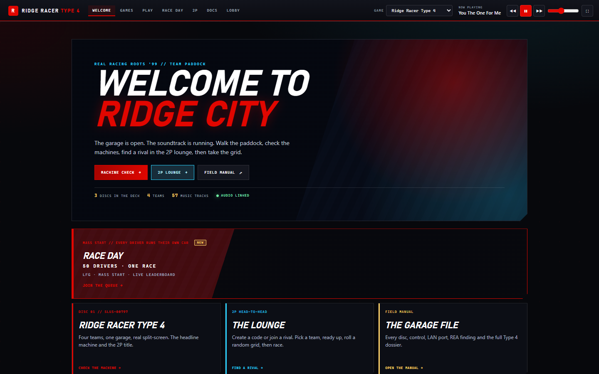
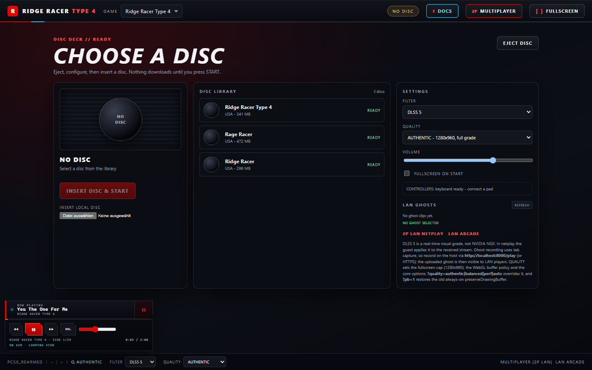
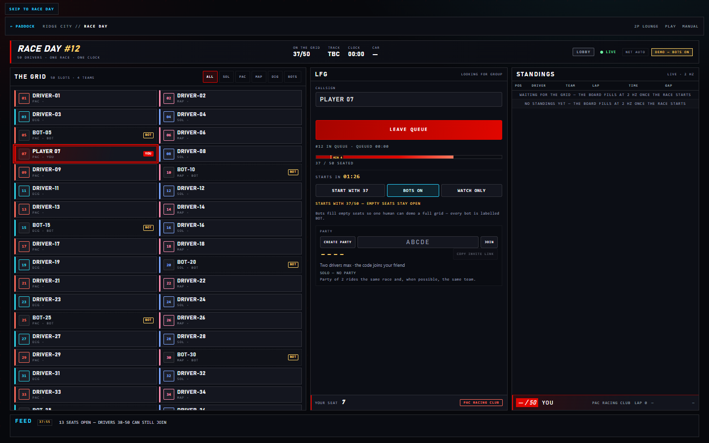
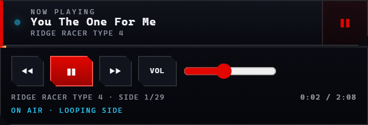

# START HERE

**Three discs, one cabinet, zero video streams.** The browser runs the
PlayStation core itself; the same Node process serves the discs, BIOS,
soundtrack and the field manual.



## Play in the browser

1. From the repository root: `cd _server` then `.\start-test.bat`.
2. Open **<http://localhost:8080/>** on the host, or
   **`http://<host-lan-ip>:8080/`** on another device on the same network.

| Route | What it is |
|---|---|
| `/` | Cabinet shell: ENTER gate, soundtrack, iframe views |
| `/play` | Disc deck and browser game (EmulatorJS 4.2.3) |
| `/multiplayer` | 2P lounge: room code, disc, teams, READY |
| `/race-day` | Race Day: up to 50 drivers, one clock |
| `/docs` | Field manual |

`/play` opens a **disc deck** first. Choose a disc, set FILTER/volume/fullscreen,
then **INSERT DISC & START**. Nothing downloads until you press START. **EJECT**
in the running header returns to the deck.

The games run locally in the browser via self-hosted **EmulatorJS /
PCSX-Rearmed** — no host video stream.



Choose **Ridge Racer Type 4**, **Rage Racer**, or **Ridge Racer (1994)** in the
GAME selector:

- Type 4 (2P VS Battle): <http://localhost:8080/play?game=r4>
- Rage Racer (1P disc / 2P shared car in the lounge): <http://localhost:8080/play?game=rage>
- Ridge Racer 1994 (1P disc / 2P shared car in the lounge): <http://localhost:8080/play?game=ridge>

**Fallback:** <http://localhost:8080/lobby> — original lobby + host-stream
mode.

**LAN netplay (2P lounge, all three discs):** open the **2P LOUNGE** —
<http://localhost:8080/multiplayer> — on both machines (from the shell, or
directly). Pick the disc with the **DISC** selector, create a room on one, join
the 4-character code on the other, pick a team, both press READY. The server
picks a course and cars from that disc's manifest and both browsers land on
`/play-net` with the same plan and `game=` key. **R4 = real VS Battle, two cars,
split screen**, and the host walks the menus automatically; **Rage Racer and
Ridge Racer 1994 = shared car** — no split screen, the host starts a normal
single-player race by hand and the guest pad is merged onto the host's car. Same
LAN origin on both machines, relay on TCP 3010. Details: **2P LAN** in
`README.md`, <a href="/docs/multiplayer/shared-car">/docs/multiplayer/shared-car</a>
and `_server/NETPLAY-INTEGRATION.md`.

**GHOST (Rage Racer / Ridge Racer 1994 only)** is the same lounge with the
`DRIVE LIVE | GHOST` control set to GHOST: turn-based, where only one driver
drives at a time (`TURN HOST | GUEST`, host-only, chosen before the grid locks).
The run you finish becomes the other player's ghost in two ways: it is **drawn on
track while you race** on **Ridge Racer 1994's race screen** and in **Rage Racer
Grand Prix** (Route B, `mpLiveGhost=1`, the default), and it is replayed full
screen on the game's own results screen afterwards (the Ridge results screen
offers `WATCH RIVAL`). Rage **Time Attack** never draws the rival slots and is
replay-only. Labels: `ghost rendered (in-game)` for the live car (drawn, not
simulated — no collision, no AI) and `ghost replay (sequential)` for the replay.
A **REMATCH flips the turn**. Honest limits: synthetic harness tapes, no human lap
yet, host-only evidence, and Rage TA stays replay-only.

Verification is scoped: multi-disc lounge transport 16/16, multi-disc lounge
UI 32/32 and the Rage shared-car host path 14/14 host-only
(`harness-verified`), lounge UI 33/33 and raw `/mp` 22/22
(`harness-verified`), shell fullscreen/embedded fill 30/30 (`harness-verified`),
host macro 6/6 (`harness-verified host-only`), the two-browser R4 race with
the guest driving P2 40/40 (`harness-verified two-browser` — two browser contexts
on one host; two physical machines still unverified; guest netplay audio is
absent, the stream is video-only), and ghost 36/36 live ghost (Ridge race screen
+ Rage Grand Prix, `harness-verified ghost rendered (in-game)`) plus 40/40 engine
and 36/36 lounge for the post-race replay
(`harness-verified ghost replay (sequential, Ridge + Rage)`). Rage/Ridge
shared-car play is still
`netplay transport; in-game mode unverified`. Run the 2P set with
`cd _server; node verify-mp.mjs` (or `--full`) plus
`node mp-games-probe.mjs`, `node test-mp-games-ui.mjs`,
`node test-mp-shared-car.mjs`, `node test-mp-live-ghost.mjs`,
`node test-mp-ghost-replay.mjs` and
`node test-mp-ghost-lobby.mjs`. See `HANDOFF.md` and
the measured numbers in `docs/pages/play/performance.mdx`.

## Race Day (one race, up to 50 drivers)

**RACE DAY:** <http://localhost:8080/race-day>



Press **ENTER** on the cabinet, then **RACE DAY** in the top bar (or open
`/race-day` directly). Type a callsign and click **FIND ME A RACE**: the LFG
panel queues you, shows the fill meter and ETA, and any queued driver can press
**START NOW** once 4 drivers are in (the button reads "START WITH n"; with bots
on, one queued driver is enough). The server rolls one of the eight R4 courses
and one car class, locks the grid for 5 s, then runs a 3-2-1 countdown; everyone
races the same course on one clock.

- **Invite a friend:** **COPY LINK** in the LFG panel copies
  `http://<host>:8080/race-day?party=CODE`. A party is two drivers and gets the
  same team when possible.
- **Watch:** `/race-day?spectate=1` is a standings-only board — no seat, no
  telemetry, no video.
- **Drive with the HUD:** `/play?mmo=1&event=<id>&seat=<n>&team=<t>` (add
  `&game=r4&threads=0`) runs R4 locally with the Race Day HUD: position
  `P7 / 50`, lap/time/best, gap chips, a top-5 board, and a FINISHED card that
  links back to `/race-day`. The race-day page shows the grid, countdown, live
  standings and results; your seat row carries the `seat`/`team` values. Nothing
  opens the HUD for you yet.
- **Demo with one human:** `/race-day?bots=1` (or `RR4_MMO_BOTS=1` on the server)
  fills empty seats with bots. Every bot is labelled `BOT`; a bot race is a demo,
  never a player race.
- **50 is the MVP target.** The server was load-probed at 550 seats with
  **synthetic WebSocket clients** (`RR4_MMO_MAX=550`): 550 sockets / 550 seats,
  0 dropped, standings 1.93–1.95 Hz, broadcast p95 527–528 ms, grid ≤1,973 B,
  standings ≤1,290 B, ~1.1–1.4 MB/s total egress. That is not 550 humans and not
  550 browser cores. There are no ghost cars in Race Day, no spectator video and no
  persistence — a server restart starts a new race day.
- The race clock (`0x800F4E2F`, mirror `0x8010C24F`) and speed (`0x800AC0EE`,
  8.8 fixed, km/h = raw / 64) are RE-confirmed; the **lap counter is
  unconfirmed**.

Verification: `/mmo` protocol 12/12 (`_runtime/mmo-protocol.json`), two-browser
Race Day 41/41 (`_runtime/mmo-e2e.json`), 24/24 captures
(`_runtime/mmo-shots.json`), 550-socket synthetic load (`_runtime/mmo-load*.json`).
Run them from `_server`: `node mmo-protocol-test.mjs`, `node test-mmo-ui.mjs`,
`node mmo-shots.mjs`, `node mmo-load-probe.mjs --drivers 550`. Details:
**Race Day** in `README.md` and `_server/README.md`.

## Music

The **default page is the R4 cabinet login** (`http://<host>:8080/`). The first
ENTER click gives the browser the audio gesture it needs and starts **"You The
One For Me"** (the R4 intro). The first view is **WELCOME TO RIDGE CITY**
(`/welcome`), the garage/paddock hub. From there: **MACHINE CHECK** (`/games`),
**2P LOUNGE** (`/multiplayer`), **RACE DAY** (`/race-day`), or the **FIELD
MANUAL** (`/docs/introduction`); the shell bar adds **PLAY**, **RACE DAY**,
**DOCS** and **LOBBY** (`/lobby`). No game starts until you choose START. The
soundtrack keeps playing
while every view loads inside the shell, and the GAME selector changes the page
theme and playlist (`r4` / `rage` / `ridge`). Every refresh returns to ENTER, and
the page always starts in Type 4 mode. The old lobby is at `/lobby`.



The player lives in `_server/public/music/` and is served at `/music`. Rebuild
the manifest after changing tracks:

```powershell
cd _server
node scripts/build-music-manifest.mjs
```

## First time on this PC

1. Double-click `_server\firewall.bat` once and approve the UAC prompt
   (only if other devices cannot reach the page).
2. Double-click `_server\start-test.bat` to serve `/play` without taking over the
   host desktop.
   Use `_server\start.bat` only if you also want the native `/lobby` fallback.
3. Wait for the server banner, then share the `/` and `/play` URLs above.
4. Rebuild the docs after page/theme changes:

   ```powershell
   cd docs
   npm install          # once
   npm run build
   ```

## Players

1. Open `/play` and choose **Ridge Racer Type 4**, **Rage Racer**, or **Ridge
   Racer (1994)**.
2. Wait for the first load: Type 4 is 341 MB, Rage Racer is 472 MB
   (495,297,808 bytes), Ridge Racer is 296 MB. EmulatorJS keeps the CHD in
   IndexedDB (`EJS_CacheLimit = 1 GiB`) and revalidates with a one-byte range
   probe, so reloads are fast.
3. Press ENTER on the audio gate, then **INSERT DISC & START**. The volume
   defaults to 70 %, and a key press, pad button or click unlocks audio. Click
   the game canvas once to focus keyboard/Start input.
4. Use **FULLSCREEN** or `F`; `Esc` exits. In fullscreen the canvas is capped at
   `min(100vw, 1280px, 100vh*4/3)` (1280×960 on a 1080p screen) so the 640×480
   core is not upscaled to 1920×1080. In the shell, `F` also works while the
   game has focus (it fullscreens the whole cabinet).
5. The FILTER menu defaults to **DLSS 5** (a real-time visual grade on the game
   canvas; Off / Scanlines / CRT / Vignette / Sharp are also available). The
   **QUALITY** menu picks AUTHENTIC / BALANCED / PERFORMANCE / AUTO for the
   fullscreen cap, buffer policy and core options. Xbox/PlayStation pads,
   keyboard, and touch work through EmulatorJS. Detected pads are auto-assigned
   since 2026-11-06 (not harness-verified); if one does not respond, open
   EmulatorJS control settings and select it.
6. Save/load states from the EmulatorJS menu; they stay in this browser.
7. For LAN ghosts, press **REC GHOST** during a run, stop to upload, then choose
   it under **LAN GHOSTS** in the disc deck; it plays in the corner while you
   race.
8. For two local players, connect two pads on one browser (R4 split-screen).
   For **LAN 2P**, open <http://localhost:8080/multiplayer> on both
   machines: pick the disc, host clicks **CREATE ROOM**, guest joins with the
   4-character code, both pick a team and press **READY**. With **R4** the
   server rolls the course and one car per driver; both browsers then land on
   `/play-net` and the host starts the VS Battle race automatically. With **Rage
   Racer** or **Ridge Racer 1994** the room is a **shared car**: the host starts
   a normal single-player race by hand and the guest pad drives the same car.
   Rage/Ridge rooms also offer **DRIVE GHOST**: the host picks `TURN HOST|GUEST`,
   only that driver drives, and the finished run becomes the other seat's ghost —
   drawn live on Ridge's race screen and in Rage Grand Prix, and replayed on the
   results screen (`WATCH RIVAL`, `ghost replay (sequential)`); the rematch flips
   the turn. Rage Time Attack is replay-only.
   The host streams its canvas at 60 fps; the guest
   picks **QUALITY** in the netplay panel (AUTO/LOW/MED/HIGH) and hears the game
   only through the host's speakers (the stream is video-only). After the race,
   click **REMATCH** on each tab: the
   host recreates the same lounge room and the guest waits for it, then both press
   READY again. The relay on TCP 3010 starts
   with the server; run `_server\firewall-netplay.bat` once if guests cannot
   connect. Details: **2P LAN** in `README.md`, the shared-car page, and
   `_server/NETPLAY-INTEGRATION.md`.
9. For a **mass start** instead of a duel, open
   <http://localhost:8080/race-day> (or **RACE DAY** in the shell). Queue
   with **FIND ME A RACE**, share the `?party=CODE` invite link, and press
   **START NOW** at 4+ drivers. The in-race HUD is
   `/play?mmo=1&event=<id>&seat=<n>&team=<t>`; details in **Race Day** above.

## Host

- `_server\start-test.bat` — web server only; best for `/play`.
- `_server\start.bat` — web server plus the native cabinet for the `/lobby`
  fallback. It attaches to an existing `RR4-LAN` window instead of launching a
  second one.
- `_server\stop.bat` — closes the server, native cabinet, and relay.
- The `:8080` server was restarted on 2026-11-06, so it serves the `/mp`
  heartbeat, host promotion and stale-room sweep. Restart it again after pulling
  new `/mp` lobby changes.
- If the WLAN address changes, run `cd _server` then
  `node make-qr.mjs http://<new-ip>:8080/play`.

Full setup, BIOS/ROM details, controls, and troubleshooting:
`_server/README.md`. Documentation rules: `AGENTS.md`.
