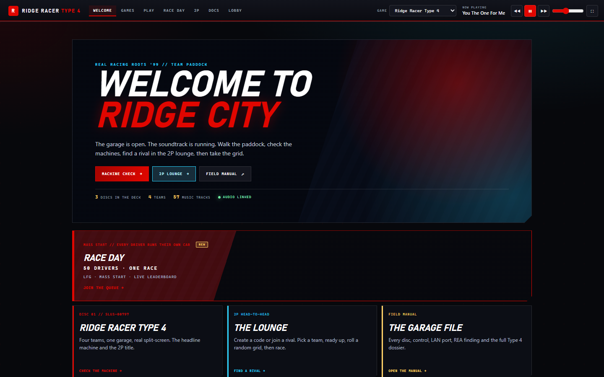
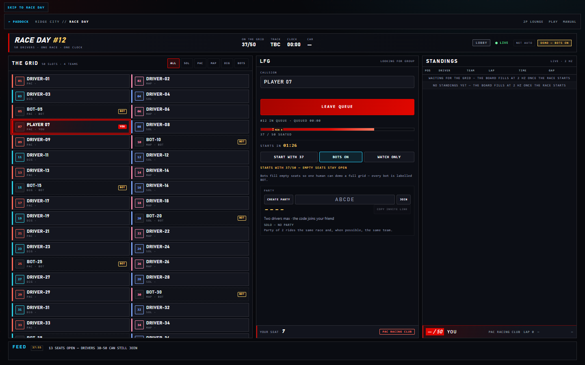

# RIDGE RACER TYPE 4 / RAGE RACER / RIDGE RACER // NATIVE BROWSER ARCADE

A zero-install LAN arcade: one ENTER shell and four ways to play.



- **`/` (cabinet shell)** — the R4 login gate. The first ENTER is the browser
  audio gesture, the intro starts, and the shell loads **WELCOME TO RIDGE CITY**
  (`/welcome`) in its iframe. From there the top bar roams to **GAMES**
  (`/games`), **2P LOUNGE** (`/multiplayer`), **RACE DAY** (`/race-day`),
  **PLAY**, **DOCS** or **LOBBY** (`/lobby`). The audio element lives in the
  parent document, so the soundtrack
  survives the iframe navigation. Every load/refresh returns to ENTER.
- **`/play` (primary)** — **Ridge Racer Type 4**, **Rage Racer** and the original
  **Ridge Racer** (1994) run **inside each player's browser** on a canvas, using
  self-hosted [EmulatorJS](https://emulatorjs.org/) and the PlayStation core
  **PCSX-Rearmed** (WebAssembly). No host video stream, no ffmpeg, no capture.
  Pick the game in the GAME selector or with `?game=r4` / `?game=rage` / `?game=ridge`.
- **`/play-net` (LAN netplay, all three discs)** — same browser emulator on the
  pinned EmulatorJS 4.3.0-pre snapshot. The host runs the game and streams over
  WebRTC; the guest joins on the same LAN origin. R4 is a two-car VS Battle;
  Rage Racer and Ridge Racer 1994 run as a shared car (both pads on one car) or
  as a turn-based ghost: a live ghost drawn from the other seat's tape while you
  race (`mpGhost=ghost&mpLiveGhost=1`, Ridge race screen + Rage Grand Prix) and a
  post-race native replay (`mpGhost=ghost`).
  Relay on TCP 3010. The normal entry is the **2P LOUNGE** (`/multiplayer`),
  which hands both browsers here with a room, a disc and a race plan.
- **`/race-day` (Race Day, mass start)** — one race, one shared clock, one
  leaderboard, up to **50 seats** (MVP). Every driver runs R4 in their own
  browser; the server owns the course roll, the start signal, the seats and the
  telemetry-derived standings (`src/mmo.js`, `WS /mmo`). LFG queue, parties of 2,
  invite links, a spectate board and labelled demo bots.
- **`/lobby` (host-stream fallback)** — the original shared-cabinet mode: the
  native recompilation runs on the host PC, is captured at up to 60 fps, and is
  streamed as MPEG-TS to jsmpeg. Two players claim P1/P2 and drive the game's
  real 2-player split-screen mode through a keyboard-pad relay.

> **Status - `/play` is verified for all three games.** Type 4 (341 MB CHD),
> Rage Racer (472 MB CHD) and Ridge Racer (296 MB CHD) boot in the browser
> canvas with OpenBIOS/HLE.
> `/lobby` remains the known-good host-stream fallback; `/` is the ENTER shell.
> **LAN netplay evidence is now layered:** R4 2P transport **21/21** (two browser
> contexts on one host), the 2P LOUNGE UI + handoff `harness-verified` **33/33**,
> raw `/mp` `harness-verified` **22/22**, the host VS Battle macro
> `harness-verified host-only` **6/6**, and the two-browser race with a guest
> driving P2 `harness-verified two-browser` **40/40**
> (`_runtime/mp-race-e2e.json`; two contexts on one host, two physical machines
> still unverified, guest audio absent). See `NETPLAY-INTEGRATION.md`.
> **The lounge now covers all three discs:** `harness-verified` **16/16**
> (`mp-games-probe.mjs`, `_runtime/mp-games.json`) for the `/mp-games.json`
> manifest, per-disc rolls, host-only `setgame` and guest adoption, and **32/32**
> (`test-mp-games-ui.mjs`, `_runtime/mp-games-ui.json`) for the two-browser DISC
> selector + `game=` handoff, and **14/14 host-only**
> (`test-mp-shared-car.mjs`, `_runtime/mp-shared-car.json`) for the real Rage
> core boot, manual stage and `player 1 → 0` remap install. R4 is still the only
> real VS Battle; Rage Racer and Ridge Racer 1994 run as a **shared car** and
> remain `netplay transport; in-game mode unverified`.
> **Rage/Ridge also have a turn-based GHOST mode with two doors.** Route A,
> `drive: ghost` without the live flag, replays the other seat's native tape after
> the run — `harness-verified ghost replay (sequential)` **40/40** engine
> (`test-mp-ghost-replay.mjs`, `_runtime/mp-ghost-replay.json`) and **36/36**
> lounge/rematch (`test-mp-ghost-lobby.mjs`, `_runtime/mp-ghost-lobby.json`).
> Route B, `mpLiveGhost=1` (the default the lounge appends), also applies that
> tape to a spare rival slot every frame so the game **draws** a second car while
> you race — `harness-verified ghost rendered (in-game)` **36/36**
> (`test-mp-live-ghost.mjs`, `_runtime/mp-live-ghost.json`), **Ridge's race screen
> and Rage Grand Prix only**; Rage Time Attack stays replay-only
> (`draw-path-unverified`). The ghost is drawn, not simulated (no collision/AI),
> the tapes are synthetic and no human lap is recorded.
> **Race Day layers on top:** `/mmo` protocol `harness-verified` **12/12**, the
> two-browser Race Day UX `harness-verified two-browser` **41/41**, the capture
> harness **24/24**, and a **550-socket synthetic** load probe (550 seats, 0
> dropped — not 550 humans). 50 seats is the MVP target.

## Quick start

### Host requirements

**For `/play` (browser emulation):**

- Windows 10/11 (the server itself is Node; the native cabinet is optional).
- Node.js 20+ (tested on 24). If `node_modules` is missing, run `npm install`
  once in `_server\`.
- Your own legally obtained R4 disc image in `..\disc\` (keep the `.cue` and
  every `.bin` track together).
- The self-hosted EmulatorJS release in `_server\public\emulator\` (EmulatorJS
  4.2.3; already present in this workspace).
- Host and players on the same LAN/WLAN, with client isolation disabled.

**Only needed for the `/lobby` host-stream fallback:**

- An interactive Windows desktop session with OpenGL. A headless service or a
  disconnected RDP session is not enough.
- The recompiled runtime in `_server\game\`.
- `_tools\ffmpeg\bin\ffmpeg.exe` (bundled in this workspace).
- Python 3 with `soundcard` and `numpy` for game audio (already installed
  here). If audio capture is unavailable, the stream falls back to video-only.

### Start the server

1. For browser play without taking over the host desktop, double-click
   **`start-test.bat`**. It starts the web server with
   `RR4_NO_AUTOSTART=1` and `RR4_STREAM_SOURCE=test`, so no native game is
   launched and `/lobby` shows a looping test capture. `/` still serves the
   ENTER shell and `/play` the browser disc deck (boot verified on all three
   discs; see `PLAY-QA.md`).
2. For the host-stream fallback, double-click **`start.bat`**. It starts the
   web server and the native cabinet, and attaches to an existing `RR4-LAN`
   window instead of launching a second game.
3. Wait for the console banner. It prints every LAN address, for example:

   ```
   RIDGE RACER TYPE 4 LAN cabinet listening on :8080
     http://localhost:8080/  (WLAN)
     http://localhost:8080/
   ```

4. On the host, use **`http://localhost:8080/`** for the ENTER shell, or
   **`http://localhost:8080/play`** for browser play. `/lobby` is the old
   lobby/fallback, `/multiplayer` the 2P lounge and `/race-day` the 50-driver
   mass start.

Shell behaviour worth knowing (2026-11-06):

- The shell fullscreen button and `F` work from the shell chrome **and from
  inside the game/docs frame** (the shell mirrors the key); the bar hides and the
  frame fills the viewport, desktop and mobile.
- Embedded `/play` and `/play-net` do **not** show a second **CLICK TO RACE**
  gate — the parent ENTER click already unlocked audio; the game unlocks on the
  next click.
- The soundtrack ducks to about **22 %** while a `/play*` view is active and
  returns to the slider level when you leave.
- Embedded `/docs` loads with `?embedded=1` and hides the manual's own header
  (`#rr4-shell-docs`), so the shell bar stays the only top bar.
5. Share the current LAN play URL with the other players:
   **`http://localhost:8080/`** (or `/play`). The lobby (`/lobby`) also
   shows a QR code; the checked-in static QR targets `http://localhost:8080/play`
   until you regenerate it for your own LAN address:

   ```powershell
   cd _server
   node make-qr.mjs http://localhost:8080/play
   ```

   The address is DHCP-assigned. If it changes, use the URL printed in the
   console, re-run `make-qr.mjs`, or use the dynamic `/qr.svg` endpoint.
6. If other devices time out, run **`firewall.bat`** once and approve the UAC
   prompt. It adds an inbound TCP 8080 rule.
7. When the host needs the desktop back, run **`stop.bat`**. It closes the
   native game and the process listening on port 8080.

### Scripts

| Script | What it does |
|---|---|
| `start.bat` | Starts the web server **and** the native cabinet for the `/lobby` fallback; opens `http://localhost:8080/` (the ENTER shell). Attaches to an existing `RR4-LAN` window. Also starts the 3010 relay. |
| `start-test.bat` | Web server only: sets `RR4_NO_AUTOSTART=1` and `RR4_STREAM_SOURCE=test`, loops `_runtime/capture-test.ts` for `/lobby`, and does **not** launch the game. Use this for `/play` and the 2P lounge. Also starts the 3010 relay. |
| `start.ps1` | PowerShell equivalent. Supports `-Test`, `-NoBrowser`, `-NoNetplay`, `-Tls` (opt-in HTTPS on `:8443` beside `:8080`). |
| `start-netplay.bat` | Starts the netplay relay on TCP 3010 (also auto-started by the launchers). |
| `stop-netplay.bat` | Stops only the relay on 3010. |
| `firewall.bat` | One-time inbound TCP 8080 firewall rule (asks for UAC). |
| `firewall-netplay.bat` | One-time inbound TCP 3010 rule, all profiles (asks for UAC). |
| `scripts\make-cert.ps1` | Self-signed cert for the opt-in TLS listener (`certs\rr4-cert.pem` / `rr4-key.pem`, `npm run cert`). |
| `scripts\https-smoke.mjs` | Edge-header smoke: strong ETag + `If-Range`, brotli, keep-alive, COOP/COEP scope, `/api/netplay-config`, section 301s (`npm run edge:smoke`). |
| `stop.bat` / `stop.ps1` | Kills the native game and the processes listening on 8080 and 3010. |

Set `RR4_NO_NETPLAY=1` (or pass `-NoNetplay` to `start.ps1`) to skip the relay
and print a reminder. The stop scripts assume ports 8080 and 3010. If you
changed `RR4_PORT`, stop the Node process manually (or stop the cabinet from
its console window).

## URLs and ports

The server binds `0.0.0.0` and serves everything on one port:

| URL | Purpose |
|---|---|
| `http://<host-lan-ip>:8080/play` | **Primary:** native browser play (EmulatorJS + PCSX-Rearmed). Loopback: `http://localhost:8080/play`; LAN: `http://<host-lan-ip>:8080/play`. |
| `http://<host-lan-ip>:8080/play-net` | **LAN netplay (2P)** on EmulatorJS 4.3.0-pre. R4 = VS Battle (ids 4), Rage = 5, Ridge = 6; Rage/Ridge use the shared-car path, or the ghost engine with `mpGhost=ghost` + `mpTurn=host`/`guest` (+ `mpLiveGhost=1` for the live ghost rendered in-game; Rage Time Attack is replay-only). Alias: `/play?netplay=1`; `/play-net.html` also works before a server restart. |
| `http://<host-lan-ip>:8080/` | **Default R4 cabinet login shell** (ENTER gate, parent-owned audio, iframe). First view after ENTER is **WELCOME** (`/welcome`); every refresh returns to ENTER. Loopback: `http://localhost:8080/`; LAN: `http://<host-lan-ip>:8080/`. |
| `http://<host-lan-ip>:8080/welcome` | **Welcome to Ridge City** hub: machine check, 2P lounge, field manual. |
| `http://<host-lan-ip>:8080/games` | **Machine check**: all three discs, specs, START / CHECK DISC DECK. |
| `http://<host-lan-ip>:8080/multiplayer` | **2P lounge**: room codes, DISC selector (`r4`/`rage`/`ridge`), DRIVE `LIVE`/`GHOST` + TURN `HOST`/`GUEST` (Rage/Ridge only, host-only before the lock), teams, both-ready; rolls from that disc's manifest (R4: 8 courses + preset cars; Rage: 4 courses; Ridge: 1 course) and hands off to `/play-net`. |
| `http://<host-lan-ip>:8080/mp-games.json` | **Disc manifest** (static, `no-cache`): the single source of truth for the lounge — keys `r4`/`rage`/`ridge`, ids 4/5/6, room prefixes `R4`/`RAGE`/`RIDGE`, `mode` (`versus`/`shared-car`), `macro` (`auto`/`manual`), tracks/cars (8/8, 4/4, 1/4). Read from disk by `src/server.js`. |
| `http://<host-lan-ip>:8080/race-day` | **Race Day**: 50-seat mass start, LFG queue, parties of 2, live standings, results. `?party=CODE` invite, `?spectate=1`, `?bots=1`. |
| `http://<host-lan-ip>:8080/lobby` | Original lobby and host-stream fallback. |
| `http://localhost:8080/play` | The same play page on the host. |
| `http://localhost:8080/lobby` | The same lobby/fallback on the host. |
| `/rom/*` | Disc images from `..\disc\`; Range requests, ETag, 7-day immutable cache. |
| `/bios/*` | BIOS images from `_server\game\bios\`; Range requests and cache headers. |
| `/docs` | Built Zudoku field manual (`docs\dist\docs`). `/docs` and `/docs/` 301 to `/docs/introduction`; `/docs/games`, `/docs/play` and `/docs/multiplayer` 301 to their first page (`DOCS_SECTION_PAGES`). |
| `/music/*` | Extracted MP3s; Range requests and long cache. |
| `GET /api/music` | Generated soundtrack manifest (`public\music\manifest.json`). |
| `/emulator/*` | Self-hosted EmulatorJS loader, core and data. Cores/WASM are cached for a year. |
| `ws://<host>:8080/ws` | Lobby, seats, input, chat, status (fallback mode). |
| `ws://<host>:8080/mp` | 2P LOUNGE transport: `create {game, drive, turn}`/`join`/`leave`, `ready`, host-only `setgame`/`drive`/`turn`, the `race` roll, `rooms` broadcasts, `ping`/`pong`, 20 s heartbeat. Room lists carry `game`/`mode`/`drive`. |
| `ws://<host>:8080/mmo` | Race Day transport: `hello`, `queue`, `party:*`, `seat`, `telemetry`, `finish`, `start`, `spectate`, `chat`, `config`, `leave`, `ping`; server frames `welcome`/`event`/`grid`/`queue`/`countdown`/`standings`/`result`/`party`/`feed`/`chat`/`error`/`pong`. |
| `ws://<host>:8080/stream` | MPEG-TS video/audio stream (fallback mode). |
| `GET /api/status` | Room and cabinet snapshot. |
| `GET /api/mmo/status` | Race Day snapshot: `ok`, `event{id,index,state,plan,bots}`, `counts{seated,queued,max,connected,bots}`, `uptimeSec`, `clients`, `p50BroadcastMs`, `max`, `min`, `path`. |
| `GET /api/health` | Lightweight health check. |
| `GET /api/netplay-config` | Relay URL/port derived from the request origin (`relayUrl`, `relayPort`, `secure`, `protocol`, `sameOrigin`, `socketPath`, `gameIds`). The relay is **not** folded in yet: `play-net.js` still builds `:3010`. |
| `https://<host>:8443/*` | Optional second listener when `RR4_TLS=1` (`RR4_TLS_PORT`, cert via `scripts\make-cert.ps1`). `:8080` keeps serving HTTP. |
| `GET /qr.svg` | Dynamic join QR; accepts `?url=` to encode a specific URL. |

`/`, `/welcome`, `/games`, `/multiplayer`, `/lobby`, `/play*`, `/docs/*` and
`/music` are served with `Cross-Origin-Opener-Policy: same-origin` and
`Cross-Origin-Embedder-Policy: credentialless`, **but only on a loopback host or
HTTPS**. A plain-HTTP LAN origin gets no COOP/COEP and no warning; loopback and
the opt-in `RR4_TLS=1` listener isolate the shell and its embedded `/play`
(`crossOriginIsolated=true`, `SharedArrayBuffer` and
`navigator.storage.persist` available). The `/rom`, `/bios`, and `/emulator`
static routes set `Cross-Origin-Resource-Policy`/CORS so the isolated page can
load them. `COEP` is `credentialless` (a one-line revert to `require-corp`).

`/play` accepts query options: `?bios=openbios|hle` or `?bios=/bios/<file>`,
`?cue=auto|file|direct`, `?threads=0` to disable / `?threads=1` to force the
threaded core, `?debug=1` for the unminified EmulatorJS sources, `?game=r4|rage|ridge`,
`?setup=1` to open the disc deck with the game preselected, `?cache=0` for the
netplay page, and `?netplay=1` to load the 4.3.0-pre netplay page (same as
`/play-net`). `/play?game=r4` boots that disc immediately; bare `/play` opens the
disc deck.

Only inbound **TCP 8080** is required for single-player `/play`. The fallback
stream uses the same port. **LAN netplay** additionally needs inbound **TCP
3010** for the relay (`firewall-netplay.bat`, all profiles); the relay is a
separate Node process (`netplay/server.js`) for EmulatorJS room list/signalling,
not a route of the 8080 app. `start-test.bat` / `start.bat` launch it in a
minimized window unless `RR4_NO_NETPLAY=1`. Set `RR4_PORT` to
use another port; the server and the console URLs follow it, but
`start.bat`/`start.ps1` still open `http://localhost:8080/`, and `firewall.bat`
plus the stop scripts assume 8080.

## Native browser play (`/play`)

Open `/play`, or take **PLAY** from the WELCOME hub (`/welcome`) or the arcade
lobby. The EmulatorJS build runs locally inside the browser tab, so the host
game instance, ffmpeg capture, and `/stream` WebSocket are not required. The hub
and lobby keep the live cabinet as an explicitly labeled fallback.

### How it works

```
browser (each player)
  └─ /play page
       └─ EmulatorJS loader + PCSX-Rearmed (WebAssembly)
            ├─ disc image  <- host: ../disc/*.bin (auto cue; ?cue=file uses the real .cue)
            ├─ BIOS        <- OpenBIOS / HLE / retail
            ├─ canvas + Web Audio
            └─ Gamepad API / keyboard / touch
```

- The PS1 game runs in the browser tab. The host only serves files; it does not
  capture, encode, or relay input for `/play`.
- EmulatorJS is self-hosted under `/emulator/` (EmulatorJS 4.2.3). There is no
  CDN dependency at runtime and no build step for the page.
- The page sets `EJS_core = 'psx'` (PCSX-Rearmed), `EJS_gameID = 4`,
  `EJS_startOnLoaded = true`, and threads only on a secure context
  (`localhost`/HTTPS, where `SharedArrayBuffer` exists); plain-HTTP LAN runs the
  non-threaded core. The boot overlay tracks the ROM download and EmulatorJS
  loading text.
- By default the single-track `.bin` gets an auto-generated cue sheet. Add
  `?cue=file` to boot the real `.cue` from `disc/` instead.
- Each browser is its own emulator, so its save states, memory card data, and
  video settings are local to that browser profile.
- Two pads in one browser give local two-player play. LAN versus across
  browsers needs netplay (see below).

### First load and ROM caching

The disc image is the large download:

| Item | Size / notes |
|---|---|
| `disc/r4.chd` | **341 MB** (357,817,282 bytes). Default Type 4 image served at `/rom/r4.chd`; verified booting in EmulatorJS. |
| `disc/rage-racer.chd` | **472 MB** (495,297,808 bytes). Rage Racer USA, 4 courses, 17 CD tracks, served at `/rom/rage-racer.chd`; verified booting in EmulatorJS. |
| `disc/ridge-racer.chd` | **296 MB** (309,882,296 bytes). Original Ridge Racer USA (SCUS-94300), 1 course, 14 CD tracks, served at `/rom/ridge-racer.chd`; verified booting in EmulatorJS (1P). |
| `disc/R4 - Ridge Racer Type 4 (USA).bin` | **621 MB** raw fallback. Served at `/rom/...bin`; the page prefers the CHD. |

How the caching works:

- `/rom` is served with `Cache-Control: public, max-age=604800, immutable`,
  a **strong** `ETag`, `Last-Modified`, and **Range** support. The strong tag is
  what makes `If-Range` + `Range` answer `206`; the old weak tag made it re-send
  the whole 357,817,282-byte CHD as a `200`.
- Text assets are brotli/gzip-compressed (`emulator.min.js` 426,343 B →
  106,924 B br); `/rom`, `/bios`, `/music`, `/ghosts` and any `Range` request are
  skipped. `keepAliveTimeout` is 65 s.
- App HTML is `no-cache`; app scripts and styles (`/js/*.js`, `/css/*.css`) are
  **`no-cache` + ETag** since 2026-11-06, so a change is picked up on the next
  load instead of after a one-hour `max-age`. EmulatorJS assets keep their own
  long-lived policy (mounted before `public/`). The `<script>` tags also carry a
  `?v=YYYYMMDD` query as belt-and-braces.
- `/play` sets `EJS_CacheLimit = 1 GiB`, so EmulatorJS caches the 341 MB / 472 MB
  image into **IndexedDB**. Reuse comes from IndexedDB, not the HTTP cache: a
  warm reload reads the body from IDB and revalidates with one `GET` +
  `Range: bytes=0-0` probe (not a `HEAD`). A hard reload, cleared site data, or a
  private window downloads it again.
- The boot overlay shows download progress; the footer shows ROM/boot timing.
  `window.__R4` exposes the same diagnostics for `test-ejs.mjs`.
- The ranged probe also detects a missing file: it shows **ROM not installed**
  instead of a black screen.
- Budget for the download on phones: 341 MB (Type 4) / 472 MB (Rage Racer) over Wi-Fi is several minutes on a
  slow link and can be costly on mobile data.
- If the image changes on the host, change the ROM URL (or clear the browser
  cache). Because the response is `immutable` for 7 days, a same-URL
  replacement can stay stale in the browser.

### BIOS options

| Option | Source | Notes |
|---|---|---|
| **OpenBIOS** (default) | `_server/game/bios/openbios.bin` (self-hosted) | Free replacement BIOS, the same image the native cabinet uses. No Sony code. |
| **HLE** | Built into PCSX-Rearmed | No BIOS file. Fastest to set up; compatibility can differ from a real BIOS. |
| **Retail BIOS** | User-supplied Sony image | Best compatibility. Put the file in `_server\game\bios\` and pass `?bios=/bios/<name>.bin`; it is not distributed with this project. |

BIOS selection is by URL, not a UI dropdown:

- `/play` — OpenBIOS (default).
- `/play?bios=hle` — HLE, no BIOS file.
- `/play?bios=/bios/scph5501.bin` — an explicit image placed in
  `_server\game\bios\`. The `/bios/` route serves that folder.

The default OpenBIOS path is `/bios/openbios.bin`. The BIOS behaviour and
retail-image compatibility are still being verified; OpenBIOS is the intended
default.

### Controllers

- **Xbox and PlayStation pads** are read through the browser Gamepad API and
  mapped by EmulatorJS. No driver or companion app is installed.
- EmulatorJS's control settings can remap keyboard and pad bindings and support
  multiple players (up to four in EmulatorJS itself).
- **Keyboard and touch** also work. EmulatorJS shows its own bindings; use its
  control settings to change them.
- The `/play` shell has no separate controller modal. Rumble/slot selection is
  EmulatorJS's, not the fallback **CONTROLLER** panel.
- Browser caveat: some browsers expose `navigator.getGamepads()` only in a
  secure context (HTTPS or `localhost`). Brave/Chromium was verified to expose
  pads on the plain-HTTP LAN URL in the fallback UI; if a pad is not detected on
  `/play`, try the host at `http://localhost:8080/play`, serve the page over
  HTTPS, or use keyboard/touch. Use a wired connection or pair the pad with the
  device before opening the page.

### Fullscreen, save states, and netplay

- **Fullscreen:** use EmulatorJS's fullscreen button. The page does not force
  fullscreen on load (`EJS_fullscreenOnLoaded = false`).
- **Save states:** EmulatorJS provides save and load state from its menu.
  `EJS_gameID = 4` keeps R4's states separate. Depending on the build's
  save-state setting, states are kept in browser storage or downloaded as a
  file. They are per browser, not shared with other players.
- **Disc deck / eject:** `/play` opens a pre-boot setup screen (disc library, local disc, FILTER/volume/fullscreen, controller status, LAN ghosts). No ROM request until **INSERT DISC & START**. **EJECT** in the running header returns to it. See `SETUP-GHOSTS.md`.
- **LAN ghosts:** **REC GHOST** records a tab clip; stop to upload; choose it under **LAN GHOSTS** in the disc deck. It plays picture-in-picture during a race. Ghost API: `/api/ghosts`; files in `_server/ghosts/`.
- **Filters / DLSS 5:** the `/play` and `/play-net` footer has a FILTER menu
  (DLSS 5 / Off / Scanlines / CRT / Vignette / Sharp). **DLSS 5** is the
  default: a real-time grade (`contrast(1.08) saturate(1.18) brightness(1.02)`)
  inspired by Merserk's Visual Enhancer; it is not NVIDIA NGX neural DLSS. The
  grade is scoped to the game canvas (`#game`), so DLSS 5 smoothing and Sharp are
  a real choice, and `.fs-exit` no longer pays a `backdrop-filter`. It persists
  per browser and works for all three games. In netplay the guest applies it to
  the received video; the host stays raw. See `DLSS5.md`.
- **QUALITY presets (`/play`):** `?quality=authentic|balanced|perf|auto`
  (stored as `rr4.play.quality`, selectable in SETTINGS and the footer).
  AUTHENTIC = the previous look; BALANCED = grade on `#game`, no
  `preserveDrawingBuffer` copy, fullscreen cap 1280×960,
  `pcsx_rearmed_icache_emulation=disabled`; PERFORMANCE = grade off plus
  `icache_emulation=disabled` and `frameskip_type=auto_threshold` /
  `threshold=33`; AUTO samples ~120 rAF intervals and ratchets down at most two
  tiers (8 s cooldown). `?pb=1|0` forces `preserveDrawingBuffer` either way;
  `preserveDrawingBuffer` is otherwise on only for an armed recorder (`?rec=1`,
  stored REC arm) or AUTHENTIC on a secure context. The fullscreen backing store
  is capped at `min(100vw, 1280px, 100vh*4/3)` (1920×1080 → 1280×960).
  Measured: 60.19–60.24 emu fps, CV 1.17–1.27 %, input p50 12.7–14.1 / p95
  34.0–38.1 ms, warm boot 1568–2475 ms — see `docs/pages/play/performance.mdx`.
- **LAN netplay (2P):** the normal path is **`/` → ENTER → 2P LOUNGE**
  (`/multiplayer`) on both machines. Pick the disc (R4 = VS Battle; Rage/Ridge =
  shared car, or the turn-based ghost replay), create or join a 4-character room,
  both drivers press **READY**, and the shell hands both browsers to `/play-net`
  with the rolled race, `&game=` and (in a ghost room) `&mpGhost=ghost&mpTurn=…`.
  The host auto-hosts `R4-`/`RAGE-`/`RIDGE-<code>`; on R4 it drives the
  VS Battle menus and gates the guest until `race-live`, on Rage/Ridge it starts a
  single-player race by hand and merges the guest pad onto its car. The raw
  **`/play-net`** panel remains the manual fallback: open **`/play-net`** (or
  `/play?netplay=1`) on **both** machines with the same LAN origin, the host
  clicks **CREATE ROOM**, the guest picks the room under **JOIN A ROOM** and
  clicks **JOIN**, then the host opens the game's 2-player mode by hand. The host
  runs the PSX core and streams canvas over WebRTC; guest input arrives as
  player 2 (R4) or is remapped onto player 0 (shared car). The netplay page uses
  the pinned **EmulatorJS 4.3.0-pre** nightly at `/emulator43/data/`; `/play`
  stays on 4.2.3. The self-hosted relay listens on **TCP 3010** and is started
  automatically by `start-test.bat` / `start.bat` (or manually with
  `start-netplay.bat`). Keep the host tab in the foreground, match `EJS_gameID` on
  both sides (4 = R4, 5 = Rage, 6 = Ridge), and keep both machines on one subnet:
  `EJS_netplayICEServers = []` means LAN candidates only. The host is
  authoritative and the netplay client has no host migration. Full details:
  `NETPLAY-INTEGRATION.md`; the shared-car page is
  `docs/pages/multiplayer/shared-car.mdx`.
- **Netplay stream:** the host captures its canvas at **60 fps**
  (`captureStream(0)` + `requestFrame()` per core frame, 8 Mbps cap, keyframe on
  `race-live`/join/freeze) and sends guest input **once** — the Socket.IO copy is
  suppressed while the data channel is open. The guest's **QUALITY** selector
  (AUTO/LOW/MED/HIGH = 1.5 Mbps/30, 4/60, 8/60) is sent to the host, and a 2 s
  `getStats()` line lands in the stage log and `window.__R4NET.stats`. Measured:
  encode 59.08 fps, guest decoded 57.44 fps, guest *presented* 42–55 fps,
  0.9–2.5 Mbps, 0 % loss, 0–1 ms RTT. **Guest audio is absent**: the 4.3 host
  captures from `Module.AL.currentCtx`, which is `null` under RWebAudio, so the
  stream is `["video:live"]` (`No audio tracks captured - guests will have no
  audio`). Escape hatches: `?capture=30 ?pin=1 ?keyframe=0 ?dedup=0 ?stats=0
  ?quality= ?desync=1 ?draw= ?video=attached`.

### What is verified, and what is not

**Verified: `/play` works.** `EJS-BOOT-REPORT.md` (status WORKING) plus
`PLAY-QA.md` (9 PASS / 2 known defects) and `_runtime/ridge-verify-result.json`
(all three discs `booted: true`) cover page boot, core load, first-load download,
IndexedDB reuse, the OpenBIOS/HLE/retail BIOS paths, pad detection, fullscreen,
save states and audio. The two open defects are pad auto-assign (a `play.js`
workaround landed 2026-11-06, no harness yet) and mobile header clipping.

**Observed:** `test-ejs.mjs` boots the page and records
`_runtime/ejs-play/result.json` (`booted: true`, all three discs). The measured
performance baseline is `_server/EJS-PERFORMANCE.md`; the post-change numbers are
in `docs/pages/play/performance.mdx` (60.19–60.24 emu fps, CV 1.17–1.27 %,
canvas 960×720, `preserveDrawingBuffer=false` on plain HTTP).

**Verified (LAN netplay transport):** R4 2P room create/join, WebRTC canvas
stream, and guest input as player 2 (21 core checks, all passing). Evidence:
`_runtime/netplay-integration-results.json` and `NETPLAY-INTEGRATION.md`.

**Harness-verified (2P LOUNGE):** two browsers, ENTER → `/multiplayer` → room
code → both READY → 3-2-1-GO → `/play-net` handoff with matching
room/race/track/car parameters, 33/33 checks. Lobby UI only: the harness holds
the `/play-net` document, so it does not prove the emulator boots. Evidence:
`_runtime/mp-lobby-ui.json` + `mp-lobby-ui-{host,guest}[-room].png`.
The raw `/mp` transport is separately `harness-verified` 22/22
(`_runtime/mp-lobby-ws.json`), including the app-level `pong` and a server
heartbeat ping on the restarted `:8080`; the host VS Battle macro is
`harness-verified host-only` 6/6 (`_runtime/mp-macro-evidence.json`), including a
final-frame check that the last capture is the race and not the yellow menu.

**Harness-verified (multi-disc lounge):** `_server/mp-games-probe.mjs` **16/16**
(`_runtime/mp-games.json`) covers the `/mp-games.json` manifest, the per-disc
rolls (r4 8 tracks/8 cars, rage 4/4, ridge 1/4), room/list `game`+`mode`,
host-only `setgame` before the lock, guest adoption of the room's disc,
invalid-key fallback, the unchanged R4 race shape and cleanup.
`_server/test-mp-games-ui.mjs` **32/32** (`_runtime/mp-games-ui.json` +
`mp-games-*.png`) drives two browsers through RAGE and RIDGE
select/create/join/host disc change/READY, asserts both handoffs carry `game=`,
the overlay reads `SHARED CAR // BOTH PADS DRIVE` with one car line, keeps the R4
VS card/two-car regression, and checks `?game=` + 390×844. Those two harnesses
hold `/play-net`, so they do not boot a core. `_server/test-mp-shared-car.mjs`
**14/14 host-only** (`_runtime/mp-shared-car.json` + `mp-shared-car-rage.png`)
boots the real Rage core, proves the manual stage, the RAGE- room prefix and the
`player 1 → 0` remap install/count; it has no guest and no live drive, so both
discs still stay `netplay transport; in-game mode unverified`.

**Harness-verified (ghost replay, Route A):** `_server/test-mp-ghost-replay.mjs`
**40/40** (`_runtime/mp-ghost-replay.json` + `mp-ghost-*.png`) proves on the real
`/play-net` page that a Ridge 161×40 tape staged in a zeroed BSS run (applier
pointer `0x80080434` repointed) is what the built-in replay (8→9) plays — the
live car pose equals the tape on every sampled frame (53–54 samples over 27
distinct playback frames) with 322/322 peer samples and a mirrored peer tape
changes the rendered frame — and that a real Rage Time Attack run is
captured, that `replayNow()` in scene 12 arms the RACE finish branch
(`g_RacePhase = 4`, `lap = raceLength + 1`) so the game enters scene 17 by itself
(107/107 pose samples, mirrored-tape frame change), plus the turn gate both ways
and an IndexedDB round trip. `_server/test-mp-ghost-lobby.mjs` **36/36**
(`_runtime/mp-ghost-lobby.json` + `mp-ghost-lobby-*.png`) drives two browsers
through the R4-disabled DRIVE control, RIDGE LIVE/GHOST + persistence, the room
card, the host-only TURN selector, the `GHOST` badge, the `DRIVER: GUEST`
overlay, both `mpGhost=ghost&mpTurn=guest` handoffs, the rematch flip to
`turn=host`, the `live` regression and 390×844. It holds `/play-net`, so it
boots no core. Both are host-only and use synthetic short tapes.

**Harness-verified (live ghost, Route B):** `_server/test-mp-live-ghost.mjs`
**36/36** (`_runtime/mp-live-ghost.json` + `mp-live-ghost-*.png`) proves on the
real `/play-net` page that `mpLiveGhost=1` installs a RAM stub (Rage GP
`0x801F4700`, 324 B / 81 words; Ridge `0x801EA610`, 208 B / 52 words), repoints
one shipped word only inside the race (`0x8003875C` `0x27BDFFD8` → `0x0807D1C0`;
`0x80015014` `0x0C0092E3` → `0x0C07A984`), drives a spare rival slot
(`0x801F4194` / `0x801EDA10`) from the tape with the slot pose equal to the record
**16/16** on both discs, and changes the rendered frame well beyond the measured
noise floor (Rage 1118 cells / 16.17 % vs 0; Ridge 846 / 12.24 % vs 83) while the
player still drives (298 / 318 units). The stub survives ~10 s, A still records in
the same run (Rage recorder kept), the turn gate is unchanged, and `mpLiveGhost`
absent → no stub/patch/LIVE row with A reaching its own replay (screen 9);
`mpGhost=live` and R4 keep B off. Rage **Time Attack** reports
`draw-path-unverified` and falls back to A, so the label is
`harness-verified ghost rendered (in-game)` for **Ridge's race screen and Rage
Grand Prix only** — the ghost is drawn, not simulated.

**Harness-verified (two-browser race):** `_server/test-mp-race-e2e.mjs` loads the
real `/play-net` in two browser contexts, matches the lounge plan, runs the host
macro to `race:live`, asserts `frames.race.raceLike === true` (`yellowPct` 0,
`nonBlackPct` 73, `meanLum` 51.7 on the current artifact), sees the guest
stream advance, and records the guest pad on the host core as `player 1, index 0,
value 1` with zero player-0 records — **40/40**, `harness-verified two-browser`
(`_runtime/mp-race-e2e.json` + `_runtime/mp-race-e2e-*.png`). Two physical
machines remain unverified and guest audio is **absent** (the stream is
video-only); the guest proof is a host-stream P2 input test, not guest-side
gameplay parity.

**Harness-verified (Race Day):** `_server/mmo-protocol-test.mjs` **12/12**
(`_runtime/mmo-protocol.json`) covers the `/mmo` lifecycle, seating and team
balance, start-now, one plan for every client, telemetry ordering and clamps,
~2 Hz standings, finish→result→lobby, the heartbeat, seat reclaim and
`/api/mmo/status`; `_server/test-mmo-ui.mjs` **41/41**
(`harness-verified two-browser`, `_runtime/mmo-e2e.json`) runs two browsers
through ENTER → RACE DAY → LFG → countdown → standings → results, the party
invite, the spectate board and the `/play?mmo=1` HUD (ROM request held, so no
emulator boot); `_server/mmo-shots.mjs` is **24/24** captures. The 550-seat
`mmo-load-probe.mjs` run is `harness-verified synthetic load`: 550 sockets,
550 seats, 0 dropped — **not** 550 humans or 550 browser cores. 50 seats is the
MVP target.

**Verified (host-stream fallback):** the native cabinet launch/attach, capture,
jsmpeg playback, seat relay, and the existing UI checks. See
`QA-REPORT.md` and the `test-*.mjs` harnesses.

## 2P LOUNGE (LAN 2P, three discs)

The lounge is the normal two-player path. It replaces the "create a room twice"
manual setup; the raw `/play-net` panel still exists for debugging. It covers all
three discs: **R4** is a real two-car VS Battle, **Rage Racer** and **Ridge
Racer 1994** are single-player discs and run as a **shared car** — or, with
`drive: ghost`, a turn-based ghost mode that replays the other seat's run.

The disc list's single source of truth is **`public/mp-games.json`**, served at
`/mp-games.json` and read by `src/server.js` at boot (the browser keeps only a
small inline fallback for the first paint).

| Disc | key / id | Room prefix | Mode | Server plan | Host start |
|---|---|---|---|---|---|
| Ridge Racer Type 4 | `r4` / 4 | `R4-` | `versus` — split screen, one car per driver | 8 courses in in-game menu order, 8 preset cars (`D1–D4`, `G1–G4`) | automatic macro |
| Rage Racer | `rage` / 5 | `RAGE-` | `shared-car` - one car, both pads drive it | 4 courses (Mythical Coast, Over Pass City, Lakeside Gate, The Extreme Oval), `CAR 1-4` | manual single-player race |
| Ridge Racer 1994 | `ridge` / 6 | `RIDGE-` | `shared-car` — one car, both pads drive it | 1 course (Seaside Route 765), `Solvalou`/`Mappy`/`Bosconian`/`Nebulasray` | manual single-player race |

Every room also carries `drive` (`live` | `ghost`, default `live`) and `turn`
(`host` | `guest`, default `host`). **GHOST is Rage/Ridge only** and is
turn-based: one driver per run, and the run that finishes becomes the other
seat's full-screen replay.

### Normal flow

1. Both players open **`http://<host-lan-ip>:8080/`**, press **ENTER**, and take
   **2P LOUNGE** from the hub (or open `/multiplayer` directly).
2. Pick the disc in the start card's **DISC** selector (default R4;
   `?game=rage|ridge` preselects it and the choice is remembered). One player
   creates a room; the code is **4 characters**. The other joins by code or from
   the room list and adopts the room's disc. Rage/Ridge also offer
   **DRIVE `LIVE`/`GHOST`** on the start card (persisted as
   `localStorage['rr4.mp.drive']`); R4 shows it disabled with `RAGE + RIDGE ONLY`.
3. In the room, **only the host** may change the disc (and, in a ghost room, the
   turn) and only before the grid locks; the guest selector is disabled. A change
   drops the old plan.
4. Both drivers press **READY**. Nothing boots before that.
5. The server rolls from that disc's manifest and broadcasts the same `race`
   payload to both sockets (`game`, `mode`, `guestPlayerIndex`, `trackSelection`,
   `trackCount`, `carCount`, `drive`, `turn` included).

   R4 courses, **in in-game menu order**:

   | Index | Course (in-game menu order) |
   |---|---|
   | 0 | Helter Skelter |
   | 1 | Wonderhill |
   | 2 | Edge of the Earth |
   | 3 | Out of Blue |
   | 4 | Phantomile |
   | 5 | Brightest Nite |
   | 6 | Heaven and Hell |
   | 7 | Shooting Hoops |

   R4 preset cars per driver: `D1`, `D2`, `D3`, `D4`, `G1`, `G2`, `G3`, `G4`.
   Rage Racer rolls `0-3` over Mythical Coast / Over Pass City / Lakeside Gate /
   The Extreme Oval and `CAR 1-4`; Ridge Racer 1994 always rolls course `0`
   (Seaside Route 765) and one of `Solvalou` / `Mappy` / `Bosconian` /
   `Nebulasray`.

6. The shell counts down 3-2-1-GO, then loads `/play-net` in the same iframe:

   ```text
   /play-net?embedded=1&threads=0&mpRole=host|guest&mpRoom=<code>
             &mpRace=<raceId>&mpTrackIndex=<r4 0-7 | rage 0-3 | ridge 0>
             &mpCarHost=<0-7|0-3>&mpCarGuest=<0-7|0-3>&game=r4|rage|ridge
             [&mpGhost=ghost&mpTurn=host|guest&mpLiveGhost=1|0]   (ghost rooms only)
   ```

   Keep those parameter names stable; `public/js/play-net.js` parses exactly
   those. `mpTurn` only travels in a ghost room. `mpGhost` is `ghost` only in a
   ghost room; the shell always emits it (`live` for a live or R4 room) while the
   standalone lounge omits it outside a shared-car room, and `play-net.js` treats
   absent/`live` identically. `mpLiveGhost=1` (Route B) is appended by the shell
   and the standalone lounge for every ghost room; `0`/absent opts out. The shell
   hides `#play-bar` / `#play-foot` inside
   the `/play*` iframe so there is only one top bar. Invite links and the rematch
   reload carry `&game=` (and `&drive=`/`&turn=` in a ghost room).
7. The host auto-hosts the relay room named by the manifest prefix —
   `R4-<code>`, `RAGE-<code>` or `RIDGE-<code>` — with password `raceId` (retry
   loop with a visible stage log). The guest retries `/list` until it finds that
   exact room, then joins.
8. **R4:** the host walks R4's real menus and starts the split-screen race. The
   guest core is frozen; its `simulateInput` is wrapped and drops input until the
   host sends `race-live` over the netplay data channel.
   **Rage/Ridge:** the host starts a normal single-player race by hand (no macro)
   and `play-net.js` remaps the guest's pad from player 1 to player 0 on the host
   core, so both pads drive the same car. The guest is live from boot; the chip
   shows `GUEST P2 SHARED` until the stream is live, then `GUEST P2 LIVE`, and
   the page brand reads `2P SHARED`.
   **Rage/Ridge GHOST:** only the `turn` seat drives (the host gate drops the
   other pad), the run is recorded into the game's own tape, the peer tape is
   drawn live on Ridge's race screen / Rage Grand Prix (`mpLiveGhost=1`), and the
   native replay plays it after the run; see the **GHOST** section below.
9. **Rematch** is one click: the game page's **REMATCH** chip posts
   `{type:'rr4-rematch', code, role, game, drive, turn}` to the shell, which
   reloads
   `/multiplayer?room=<code>&host=1|0&embedded=1&game=<key>[&drive=ghost&turn=<next>]`.
   The host recreates the same code (the server reclaims it if the old room only
   holds dead sockets) and the guest retries `join` until it exists; both press
   READY for a fresh plan on the same disc. A ghost rematch flips the turn. A
   manual `/play-net` join (no `mpRole`/`mpRoom`) is not gated — no macro runs
   there.

### Host VS Battle macro (R4 only)

`macro: auto` is R4-only (`macroVerified: true`). The host reads the R4 main-menu
selection byte `0x800AC801` (label table `0x800A2180`) to verify it is on the
main menu, then:

```text
Down x2 -> VS battle
  -> car P1   (Right x carHost) -> car data -> AT/MT -> AT
  -> car P2   (player index 1, Right x carGuest) -> car data -> AT/MT -> AT
  -> course   (Right x trackIndex) -> Circle (start)
```

If the menu ever moves, recalibrate with
`node mp-calibrate.mjs plans/attract.json` (or another plan in `_server\plans\`)
and compare with `_runtime/calib/` before changing the delays. Rage Racer and
Ridge Racer 1994 have **no** macro (`macro: manual`, `macroVerified: false`) and
no menu address is documented for them.

### GHOST — Route A replay + Route B live ghost (Rage/Ridge)

Turn-based on the host core: **one driver per run**. The peer gets a ghost in two
ways, both shipped:

- **Route A — post-race native replay**, labelled **`ghost replay (sequential)`**.
- **Route B — live ghost rendered in-game**, labelled **`ghost rendered
  (in-game)`**, on **Ridge Racer 1994's race screen** and **Rage Racer Grand
  Prix** only. Opt-in `mpLiveGhost=1`, which the shell and the standalone lounge
  append for every ghost room (the default); `0`/absent leaves A byte-identical.
  Rage **Time Attack** never draws the rival slots, so it stays replay-only
  (`GHOST // REPLAY (draw-path-unverified)`). The ghost is **drawn, not
  simulated**: no collision, no shadow, no AI.

Design + probes: `../_runtime/ghost-research/` (`IMPLEMENTATION-A.md`,
`tape-probe.md`, `rage-finish-probe.md`, `live-ghost-probe.md`,
`ridge-live-ghost.md`, `ghost-tape.md`).

- **Lounge:** `DRIVE LIVE|GHOST` on the start card (Rage/Ridge only, persisted as
  `rr4.mp.drive`), room card `DRIVE GHOST // TURN-BASED TIME TRIAL`, host-only
  `TURN HOST|GUEST` before the lock (guest read-only), rooms-list `GHOST` badge,
  GO overlay `DRIVER: HOST|GUEST` with one `SHARED // <car> · DRIVER: …` line.
- **Engine (`public/js/play-net.js`, `window.__R4GHOST`):** finds the PSX 2 MiB
  window by scanning `Module.HEAPU8` for the exe text at `0x80010000`
  (`ramBase = hit - 0x80000000`, one hit, cached per page); `rd8/16/32`,
  `wr8/16/32`, `captureNow()`, `replayNow()`, `state`, `peer`, `tape`,
  `lastError`. Tapes: IndexedDB `rr4-ghost` → `runs`, key `${room}:${game}`, one
  record per seat (`host`/`guest`, newest wins), in-memory fallback, cap
  43,200 B.
- **Ridge Racer 1994:** screen id `0x801D6D28` (7 results, 8 replay setup,
  9 playback), frame counter `0x80176AE4`, count `0x801EB020`, recorder idle
  `0x801D6D18`, 40-byte records. Capture on screen 7 clamped to **161 records**
  (the applier cap before the screen dispatch table `0x8006E7BC`); stage the peer
  tape in a zeroed BSS run and repoint the applier pointer `0x80080434`
  (writes at the documented fixed base `0x8006CE7C` never reach the applier);
  swap before the results wait ends, never on 8/9, and never rewrite the count.
  `WATCH RIVAL` arms 8 → 9 from the results screen.
- **Rage Racer:** scene id `0x801E3FEC`, scene timer `0x801E3DC0`, tape base
  `0x801E8804`, count `0x8019C874`, write `0x801E48B8`, read `0x801F30C4`,
  wrapped `0x8009E994`, mode `0x801E4AB4` (1 GP / 0 TA), stride 48 GP / 28 TA.
  Capture at scene 15/16 before 17 (clamp 900 GP / 1542 TA samples and
  `floor(43200/stride)`); swap at 16/17 only for a same-`mode` peer (else
  `GHOST // MODE MISMATCH`), re-seeding `count`, `write = N + 2`, `read = 0`,
  `wrapped = 0`. `replayNow()` in scene 12 arms the RACE frame's own finish
  branch (`g_RacePhase` `0x801E6B7C` = 4, `lap = raceLength + 1`, finish timer
  0), so the game calls `BeginReplay` + `SetScene(17)` itself — **no scene
  poke**. The run's tape is captured at the first scene-17 tick (15/16 are only
  a fallback), before the peer swap.
- **Turn gate (host only):** wraps `gameManager.functions.simulateInput`
  (`turn=host` keeps player 0 and drops player 1; `turn=guest` keeps player 1
  remapped to 0 and drops player 0; `mpGhost.gatedInputs` /
  `.remappedInputs`). The shared-car remap is not installed in ghost mode; a ghost
  guest installs no local gate and is live from boot.
- **Scheduler/logs:** one ~16 ms interval; capture once per run, swap once before
  the replay; `GHOST // CAPTURED <seat> <n>f`, `GHOST // REPLAY <peer> <n>f`,
  `GHOST // NONE`; panel `GHOST // REPLAY HOST RUN` /
  `GHOST // WAITING FOR RIVAL` / `GHOST // NO TAPE YET`; chip prefixed `GHOST`.
- **Route B (`window.__R4NET.live`):** the stub is written at boot but the hook
  word is **only applied inside the race** and restored outside (a boot-time patch
  stalls Rage's scene-32 prologue). Ridge: hook `0x80015014` `0x0C0092E3` →
  `0x0C07A984`, stub `0x801EA610` (208 B / 52 words) in a runtime-verified quiet
  BSS band with a guard word that re-places the block if the game overwrites it,
  slot 11 `0x801EDA10` (array base `0x801ECE34`), tape `0x801E4840` (600 × 40 B),
  applier `0x8002A894`, `0x80080434` saved/restored per apply, count gate
  `0x801EB020`. Rage GP: hook `0x8003875C` `0x27BDFFD8` → `0x0807D1C0`, stub
  `0x801F4700` (324 B / 81 words), slot `g_Cars[10]` `0x801F4194`, second-buffer
  tape `0x801F4850`, pointers `0x8009EDAC`/`0x8019C4AC` swapped per apply, recorder
  `0x80036F4C` kept. Panel statuses `GHOST // LIVE (RIDGE)` / `GHOST // LIVE
  (RAGE GP)` else `GHOST // REPLAY (not-in-race|guest-core|
  draw-path-unverified)`; the LIVE row adds an ON/OFF toggle and
  `SYNTHETIC <n>f x <stride> B @ 0x…`.

### Manual fallback

`/play-net` (or `/play?netplay=1`) on both machines: host **CREATE ROOM**, guest
**JOIN**, then the host opens the game's 2-player mode by hand. This is the
debugging path; for R4 the guest still cannot drive until the host is in a 2P
race, while a shared-car room is live immediately. Add `&game=r4|rage|ridge` if
you select the disc by URL.

### `/mp` transport

`ws://<host>:8080/mp` carries the lounge. The current build adds:

- a **20 s heartbeat**; a socket that never answers a protocol-level ping is
  terminated, which drops its player and promotes the guest to host;
- host promotion when the host socket dies (relay-side; the EmulatorJS client
  still does not adopt it);
- `rooms` broadcasts on create/join/leave/close, so every lounge client sees the
  list change;
- application-level `ping` -> `{type:'pong', at}`;
- a **5-minute stale-room sweep** for rooms whose sockets are all gone.

Game-aware messages for the multi-disc lounge (every existing field/message is
kept, so a legacy R4 client without `game` still works):

| Message | Payload | Notes |
|---|---|---|
| `create` | `{name, code, game, drive?, turn?}` | `game` is a manifest key; missing/unknown falls back to `r4`. `drive` ∈ `live`/`ghost` (default `live`), `turn` ∈ `host`/`guest` (default `host`); both whitelisted |
| `setgame` | `{game}` | host only, `!room.started`, whitelisted key; clears `track`/`cars`; a guest or late `setgame` gets `{type:'error'}` |
| `drive` / `turn` | `{drive}` / `{turn}` | host only, `!room.started`, whitelisted (`live`/`ghost`, `host`/`guest`); a guest or late frame gets `{type:'error'}`. Ghost mode only |
| `race` (server) | `{code, raceId, game, mode, guestPlayerIndex, trackSelection, trackCount, carCount, drive, turn, track, trackIndex, cars}` | one identical payload for both seats |
| `room` / `rooms` (server) | `room` adds `game`/`mode`/`modeLabel`/`trackSelection`/`drive`/`turn`; each room-list entry adds `game`/`mode`/`drive` | `join` sends the code only — the room's disc wins |

The roll is `trackIndex = abs(seed + code.charCodeAt(0)) % tracks.length` and
`carIndex = abs((seed >> (i*3)) + i) % cars.length`, with `tracks`/`cars` taken
from the room's manifest entry (8/8 for r4, 4/4 for rage, 1/4 for ridge).

Verified on a throwaway instance on port **8095** with
`_server/mp-heartbeat-probe.mjs` (10/10, console only: create/join, ping/pong,
full room hidden, host death promotion, room cleanup, silent-socket termination,
stale-room cleanup). The long-running `:8080` process was **restarted on
2026-11-06** and serves the heartbeat build; `mp-ws-probe.mjs` records the
app-level `pong` and one server heartbeat ping there. A `:8080` process older
than the **multi-disc** change answers `create`/`room` **without**
`game`/`mode` (checked 2026-11-06) and serves `/mp-games.json` with a 1-hour
cache; restart it (`start-test.bat`) before a manual DISC-selector check. To
restart it after a future change, run `_server\start-test.bat` (web server only)
or `_server\start.bat` (web server + native cabinet). To run the throwaway
instance:

```powershell
cd _server
$env:RR4_PORT='8095'; $env:RR4_NO_AUTOSTART='1'; $env:RR4_STREAM_SOURCE='test'; node src/server.js
# second terminal:
node mp-heartbeat-probe.mjs 8095
```

`:3010` is still the separate EmulatorJS relay process, not part of `/mp`.

### Tests and what they prove

| Command (from `_server`) | Proves | Label |
|---|---|---|
| `node test-mp-lobby-ui.mjs` | Two real browsers: ENTER, 2P LOUNGE, same room code, both READY, GO, matching `/play-net` handoff, and the one-click rematch back to the same room (host auto-create, guest retry-join) starting a second race. Holds the `/play-net` document, so **not** an emulator boot. | `harness-verified` 33/33 (`_runtime/mp-lobby-ui.json`) |
| `node mp-ws-probe.mjs` | Raw `/mp`: hello/rooms, create/join, role per socket, host READY, no race before both are ready, identical `race` roll (code/raceId/track/index/cars), app-level `pong`, server heartbeat ping, protocol pong, room gone after leave. | `harness-verified` 22/22 (`_runtime/mp-lobby-ws.json`; saved run targets the restarted `:8080`) |
| `node mp-games-probe.mjs` | Multi-disc `/mp` + manifest: `GET /mp-games.json` shape, per-disc rolls (r4 8/8, rage 4/4, ridge 1/4), room/list `game`+`mode`, host-only `setgame` before the lock, guest adoption of the room's disc, invalid-key fallback, unchanged R4 `race` population, identical payloads, room cleanup. Spawns its own `:8097`. | `harness-verified` 16/16 (`_runtime/mp-games.json`) |
| `node test-mp-games-ui.mjs` | Two browsers: RAGE and RIDGE select/create/join/host disc change/READY/GO, both handoffs carry `game=`, shared-car overlay + one car line, R4 regression (VS BATTLE card, two cars, `game=r4`), `?game=` deep link, `localStorage` persistence, 390×844 overflow. Holds `/play-net`, so no emulator boot and no Rage/Ridge in-game proof. Spawns its own `:8093`. | `harness-verified` 32/32 (`_runtime/mp-games-ui.json` + `mp-games-*.png`) |
| `node test-mp-shared-car.mjs` | Host-only real Rage boot: `mode=shared-car`/`macro=manual`, plan clamps to 4 courses/4 car slots, `RAGE-` room, `2P SHARED` brand, `mpRun()` = `macro:manual` with no R4 stages, and the `player 1 → 0` remap installs on `gameManager.functions.simulateInput` and counts a press. One browser, no guest, no live drive. Spawns its own `:8094`. | `harness-verified host-only` 14/14 (`_runtime/mp-shared-car.json` + `mp-shared-car-rage.png`) |
| `node test-mp-ghost-replay.mjs` | Host-only real cores: Ridge 161×40 synthetic tape staged in a zeroed BSS run with the applier pointer `0x80080434` repointed, the built-in replay reached (8→9), the pose equals the tape on every sampled frame (53–54 samples, 27 distinct playback frames) with 322/322 peer samples and a mirrored peer tape changing the rendered frame; Rage real TA run captured, scene-12 finish arm → scene 17 with no scene poke, 107/107 pose samples, mirrored-tape frame change; turn gate both ways; IndexedDB round trip; `mpGhost=live`, R4 and ghost-guest paths off. Spawns its own `:8096` (walks to the next free port). | `harness-verified ghost replay (sequential)` 40/40 (`_runtime/mp-ghost-replay.json` + `mp-ghost-*.png`); synthetic tapes |
| `node test-mp-live-ghost.mjs` | Host-only real cores, one per disc, synthetic tapes: `mpLiveGhost=1` installs the RAM stub (Rage GP `0x801F4700` 324 B / 81 words; Ridge `0x801EA610` 208 B / 52 words) and repoints one shipped word only inside the race (`0x8003875C` `0x27BDFFD8` → `0x0807D1C0`; `0x80015014` `0x0C0092E3` → `0x0C07A984`); the ghost slot (`0x801F4194` / `0x801EDA10`) carries the tape pose 16/16 on both discs; the A/B frame delta beats the measured noise floor (Rage 1118 cells vs 0; Ridge 846 vs 83); the player still drives (298 / 318 units); the stub survives ~10 s; A keeps recording in the same run; the turn gate is unchanged; `mpLiveGhost` absent, `mpGhost=live` and R4 keep B off; Rage TA is `draw-path-unverified` and falls back to A. Spawns its own `:8088` (walks) and re-probes `:8080`. | `harness-verified ghost rendered (in-game)` 36/36 (`_runtime/mp-live-ghost.json` + `mp-live-ghost-*.png`); Ridge race screen + Rage GP only, **drawn not simulated** |
| `node test-mp-ghost-lobby.mjs` | Two browsers: R4 drive control disabled + unchanged handoff, RIDGE LIVE/GHOST + `rr4.mp.drive`, room `DRIVE GHOST` with host-only `TURN`, rooms-list `GHOST` badge, read-only guest selectors, `DRIVER: GUEST` overlay, both handoffs `mpGhost=ghost&mpTurn=guest`, rematch flips to `turn=host`, `live` regression, 390×844 overflow. Holds `/play-net`. Spawns its own `:8093`. | `harness-verified ghost replay (sequential)` 36/36 (`_runtime/mp-ghost-lobby.json` + `mp-ghost-lobby-*.png`) |
| `node mp-macro-test.mjs` | Host-only real R4 boot, menu-byte verification, full VS Battle macro to `race:live`, split-screen, and a final-frame check that the last capture is the race (yellow menu fraction 0). No guest. | `harness-verified host-only` 6/6 (`_runtime/mp-macro-evidence.json`, `_runtime/mp-macro-final.png`, `_runtime/mp-macro-0*.png`) |
| `node test-mp-race-e2e.mjs` | Two browser contexts, real `/play-net` in both, plan matches the lounge roll, macro reaches `race:live`, race frame metrics pass, guest video advances, guest pad recorded on the host as P2. | `harness-verified two-browser` 40/40 (`_runtime/mp-race-e2e.json` + `_runtime/mp-race-e2e-*.png`) |
| `node test-shell-fs.mjs` | Shell fullscreen (button/`F`/exit, bar hidden, iframe fills, desktop + mobile), `F` from inside the iframe, no second audio gate in embedded `/play`, soundtrack ducking, and one-top-bar/embedded fill for `/play`, `/play-net`, `/multiplayer`, `/docs`. | `harness-verified` 30/30 (`_runtime/shell-fs.json` + `_runtime/shell-fs-*.png`) |
| `node verify-mp.mjs` / `--full` | Runs the suites above in one table (fast set, or + the two-browser race). | wrapper only |
| `node mp-calibrate.mjs plans/<plan>.json` | Recalibration harness: boots R4, replays a plan, screenshots frame changes and reads PSX RAM (`_runtime/calib/`). Used to derive the menu byte, car order and course order. | calibration only |

Evidence files in `_runtime/`:

- `mp-lobby-ui.json`, `mp-lobby-ui.log`, `mp-lobby-ui-{host,guest}.png`,
  `mp-lobby-ui-{host,guest}-room.png`
- `mp-lobby-ws.json`
- `mp-macro-evidence.json`, `mp-macro-test.log`, `mp-macro-*.png`,
  `mp-macro-final.png`
- `mp-games.json`, `mp-games-ui.json`, `mp-games-ui.log`,
  `mp-games-lounge-{host,mobile}.png`, `mp-games-grid-{rage,ridge}.png`
- `mp-shared-car.json`, `mp-shared-car-rage.png`
- `mp-ghost-replay.json`, `mp-ghost-ridge-replay.png`, `-ridge-replay-b.png`,
  `mp-ghost-rage-{menu,select,race,scene17,replay,frozen-a,frozen-b}.png`
- `mp-ghost-lobby.json`, `mp-ghost-lobby-{host,overlay,mobile,rematch}.png`
- `mp-live-ghost.json`, `mp-live-ghost-rage-{off,on}.png`,
  `mp-live-ghost-ridge-{off,on}.png`, `mp-live-ghost-a-replay.png`
- `ghost-research/` — Route A design (`IMPLEMENTATION-A.md`), `tape-probe.md`,
  `rage-finish-probe.md`, `ridge-rea.md`, `rage-rea.md` (REA reports),
  `live-ghost-probe.md`, `ridge-live-ghost.md`, `ghost-tape.md` (Route B)
- `mp-race-e2e.json`, `mp-race-e2e-{host,guest}.png` (the two-car VS grid), plus
  `-host-go`/`-guest-go`, `-guest-car-p1`/`-guest-car-p2`, `-host-course`,
  `-host-loading`, `-host-live6s`/`-guest-live6s`, `-host-race`/`-guest-race`
  and `-guest-before`/`-guest-after`
- `shell-fs.json`, `shell-fs.log`, `shell-fs-*.png` (fullscreen + embedded fill)
- `calib/` — course/car order calibration screenshots

Do not describe the 2P path as more than `harness-verified two-browser` on one
host: the 40/40 run has `summary.failed === 0`, but two physical machines remain
unverified and guest audio is absent (video-only stream).

### Known 2P limitations

- **Two physical machines are unverified; guest audio is absent.** The 6/6
  host-only macro is still not "2P works" on its own; the 40/40 two-browser race
  is the 2P proof, on one host. The netplay stream is video-only
  (`["video:live"]`, `No audio tracks captured`), so the guest hears the race
  only through the host's speakers — a fix, not an unverified yes/no.
- **Standalone `/multiplayer` (outside the shell)** carries the plan since
  2026-11-05/06: `mpTrackIndex`/`mpCarHost`/`mpCarGuest`/`game` are appended from
  the server's `race` message, so `/play-net` no longer rerolls. The shell path
  (`/` → ENTER → 2P LOUNGE) is still the normal entry.
- **Fullscreen shell button is wired and harness-verified** (`_server/test-shell-fs.mjs`
  30/30). EmulatorJS's own fullscreen control inside `/play` remains available.
- **Host tab must stay foreground**; background throttling freezes the guest
  stream.
- **Same `EJS_gameID` and one subnet.** R4 = 4 (VS Battle, real 2P), Rage = 5 and
  Ridge = 6 (shared car). Rage Racer and Ridge Racer 1994 are single-player on
  disc, so their in-game 2P mode is a merged pad on one car and is
  `netplay transport; in-game mode unverified`.
- **No automatic macro on Rage/Ridge.** The host starts a single-player race by
  hand; no menu address or course calibration is claimed for those discs. The R4
  macro/6/6/40/40 evidence remains R4-only.
- **The ghost is drawn, not simulated.** `drive: ghost` gives the peer two things:
  a **live ghost** rendered from the tape on **Ridge's race screen** and **Rage
  Grand Prix** (`mpLiveGhost=1`, the default), and a post-race full-screen replay
  (`WATCH RIVAL` on Ridge; the race's own finish branch on Rage). There is no
  physics car, no collision, no shadow and no AI; **Rage Time Attack** has no
  rival-slot draw path and is replay-only (`draw-path-unverified`). The harness
  tapes are synthetic (Ridge 161 records for A / 600 for B, Rage a short Time
  Attack run — 100 subframes / 50 samples — plus a 240-subframe GP tape for B,
  stopped by the finish arm), and no human lap has been recorded.

### Known limitations (shell, `/docs`, native)

- **Fullscreen shell button is wired and harness-verified** (`_server/test-shell-fs.mjs`,
  30/30). EmulatorJS's own fullscreen control inside `/play` is still available.
- **Console warnings.** `/docs/introduction` logs a React #418 hydration warning;
  the page renders. Netplay logs `[NETPLAY] No ICE servers configured`. A
  plain-HTTP LAN origin logs **no** COOP warning, because the server sends
  COOP/COEP only on loopback/HTTPS. Do not claim "0 console errors".
- **Native `--debug-port` is compiled out** (`PSX_NO_DEBUG_TOOLS`), so the relay
  uses Win32 `keybd_event` instead of the debug server.
- **Native `recomp-net` is stubbed** (`netplay start failed (-1) -- built without
  recomp-net`); the 2P modes are split-screen and EmulatorJS netplay, not the
  recomp's own netplay.
- **Native input defaults are not P2-ready.** `RidgeRacer4Recomp/keybinds.ini`
  maps `[player2]` identically to `[player1]` and
  `RidgeRacer4Recomp/settings.toml` has `p2_device = "none"`. The LAN copy in
  `_server\game\` overrides both (`settings.toml` uses the keyboard; the relay
  map is distinct). Setting up the standalone native install for local 2P needs
  those edits by hand.

## Race Day (`/race-day`, `WS /mmo`)

One mass-start race, up to **50 drivers** (MVP; architected for 500), one shared
clock, one leaderboard. Every driver runs R4 in their own browser, so the server
streams no video: it owns the course/car roll, the start signal, the seats and
the standings. Server `src/mmo.js` (mounted from `src/server.js`); page
`public/mmo.html` + `public/js/mmo-client.js`, `mmo-ui.js`, `mmo-lfg.js`,
`mmo-spectate.js`, `mmo-hud.js` (+ `css/mmo.css`, `mmo-lfg.css`, `mmo-hud.css`).



Screens (desktop 1440×900 + phone 390×844) live in `public/img/race-day/` and
are regenerated with `node mmo-shots.mjs`; the originals stay in
`_runtime/mmo-shot-*.png`. They are injected-state captures, not a 50-human race.

### How a race day runs

1. Open `/` → **ENTER** → **RACE DAY** (or `/race-day` directly). `/welcome` has
   the primary card; `/games` has the R4-only CTA; `/multiplayer` cross-links.
2. **FIND ME A RACE** sends `queue`; the server seats you in `lobby` (or queues
   you for the next event if a race is live).
3. The grid closes when `MAX` seats are taken or the fill timer expires, needs at
   least `MIN` queued drivers, and any queued driver may press `start`
   (**START NOW**, labelled "START WITH n").
4. `grid` (5 s) freezes the seat list and the plan, `countdown` runs 3-2-1 with
   `startsAt`, `racing` takes telemetry at ≤4 Hz and broadcasts standings at
   2 Hz, `results` freezes 50 rows for 20 s, then the next event starts.
5. The in-race HUD is `/play?mmo=1&event=<id>&seat=<n>&team=<t>`
   (+ `&game=r4&threads=0`). Nothing auto-navigates from `/race-day` today; the
   HUD's FINISHED card links back to `/race-day`.

```text
lobby ──min queued && (seats == MAX || fill timer)──► grid
grid ──GRID_MS──► countdown (3,2,1) ──► racing
racing ──all finished || race timeout──► results
results ──RESULTS_MS──► lobby (next event id, index + 1)
```

### Environment knobs

All read once at start in `src/mmo.js` (restart `:8080` after changing them):

| Variable | Default | Meaning |
|---|---|---|
| `RR4_MMO_MAX` | `50` | seats on the grid (1..1000) |
| `RR4_MMO_MIN` | `4` | queued drivers needed before START NOW / the fill timer can start |
| `RR4_MMO_FILL_MS` | `60000` | fill window in `lobby` |
| `RR4_MMO_GRID_MS` | `5000` | grid-locked assemble time |
| `RR4_MMO_COUNTDOWN_MS` | `3000` | 3-2-1 window |
| `RR4_MMO_RESULTS_MS` | `20000` | results hold before the next event |
| `RR4_MMO_RACE_TIMEOUT_MS` | `600000` | hard race timeout |
| `RR4_MMO_HEARTBEAT_MS` | `20000` | protocol-ping heartbeat (min 500) |
| `RR4_MMO_SLOW_BACKLOG` | `65536` | `bufferedAmount` above which a socket skips standings ticks |
| `RR4_MMO_BOTS` | unset | `1` starts with demo bots enabled (`?bots=1` per client too) |

### `WS /mmo` messages

Client → server (JSON text frames):

| `type` | Payload | Notes |
|---|---|---|
| `hello` | `{name, driverId?, partyCode?}` | first frame; the same `driverId` reclaims its seat for 30 s (newest socket wins) |
| `queue` | `{partyCode?, seat?}` | idempotent; seats in `lobby`, parks in `pending` during a race |
| `unqueue` | `{}` | leaves the queue and releases a seat in `lobby` |
| `party:create` / `party:join` | `{code?}` | party of ≤2; answered with a `party` frame |
| `seat` | `{seat}` | move to a free seat in `lobby`; `full`/`state` errors otherwise |
| `telemetry` | `{t, lap, raceTimeMs, speedKph, state}` | `state` ∈ `countdown`/`racing`/`finished`; ≤4 Hz |
| `finish` | `{raceTimeMs, lap}` | explicit finish; the server also infers it |
| `start` | `{}` | START NOW; needs `MIN` queued and `lobby` state (bots on: one queued human is enough) |
| `spectate` | `{}` | no seat, standings only |
| `config` | `{bots: true\|false}` | bots demo toggle; 1/s without a seat |
| `chat` | `{text}` | ≤120 chars, 1/s; echoed to everyone as a `chat` frame |
| `leave` | `{}` | drop queue + seat |
| `ping` | `{at}` | answered with `pong` |

Server → client (every frame carries `seq` and `event`):

| `type` | Payload |
|---|---|
| `welcome` | `{driverId, you:{seat,team,name,car,bot}, state, event:{id,index,plan}, counts, max, min, bots}` |
| `event` | `{id, index, state, plan:{trackIndex,trackName,carClass,laps,rolledAt,startsAt?,startedAt?}, counts}` |
| `grid` | `{seats:[{seat,team,name,driverId,bot,state,connected}], counts, full}` — a full snapshot after `hello`, deltas afterwards; big grids arrive as ordered chunks (`part`/`parts`) |
| `queue` | `{position, size, etaMs, fillMs, party, spectating?}` |
| `countdown` | `{n, startsAt}` |
| `standings` | `{rows:[{seat,name,team,lap,raceTimeMs,gapMs,position,bot?,state?,gapLap?}], you:{position,gapMs}, lap, top}` |
| `result` | `{rows:[…50], you:{position,raceTimeMs}, finishedAt}` |
| `party` | `{code, size, members:[{driverId,name,seat}]}` |
| `feed` | `{at, text}` — one race-log line, at most 1/s |
| `chat` | `{at, seat, name, team, text}` — echo of the sender's line |
| `error` | `{code, message}` — `code` ∈ `full`/`state`/`party`/`rate`/`bad_telemetry` |
| `pong` | `{at, serverAt}` |

Standings sort is **lap desc, then `raceTimeMs` asc**; `gapMs` is the gap to the
car directly ahead **on the same lap**, otherwise `null` with `gapLap:true`.
Frames carry top-N + self + neighbours; the full 50-row table only exists in
`result`.

### Telemetry contract

The browser reads the emulated PSX RAM (`public/js/mmo-hud.js`) and reports:

| Field | Address / rule |
|---|---|
| race clock | `0x800F4E2F` — u32 LE, 1 count = 1 ms; mirror `0x8010C24F` |
| speed | `0x800AC0EE` — u16 LE, 8.8 fixed point, km/h = raw / 64 |
| finish | the clock flips from a live value to `0xFFFFFFFF` |
| lap | **unconfirmed** — no address is claimed; lap boundaries are inferred from clock resets |

RE evidence: `_runtime/analysis/14-ram-telemetry.md` (three HUD-matched
captures; 267 s monotonic run 10 660 → 277 506). The HUD is RAM-first and
claims `source:'ram'` once the label-table anchor finds a moving clock
(measured 1007 counts per wall second, 1002 per emulated frame); it falls back
to `stopwatch` only when no anchored clock is found. The in-game clock pins at
599 999 ms (9:59.999), so a longer race reports a capped time. The server clamps
`lap` 1..99,
`raceTimeMs` 0..3,600,000, `speedKph` 0..400, rejects a backwards
`raceTimeMs`, and derives position from that telemetry — never from a
client-claimed place.

### Scale budget (measured, not theoretical)

`node mmo-load-probe.mjs --drivers 550` against an instance with
`RR4_MMO_MAX=550` — 550 **synthetic WebSocket clients**, no browser:

| Path | Measured |
|---|---|
| standings cadence | 1.93–1.95 Hz |
| broadcast inter-arrival | p95 527–528 ms, p99 531 ms |
| grid frame | ≤1,973 B |
| standings frame | ≤1,290 B at 550 seats (top-N + self + neighbours; the 50-client protocol run saw 1,497 B, budget 1,500 B) |
| total egress | ~1.1–1.4 MB/s (1.7–2.5 kB/s per client) |
| dropped sockets / frames | 0 |

The code keeps the budget rules: skip a standings tick when
`bufferedAmount > RR4_MMO_SLOW_BACKLOG`, coalesce grid broadcasts to one per
100 ms, and build one shared JSON payload instead of stringifying per recipient.
**50 is the MVP target**; 500 is the target the budgets are sized for. 550
sockets is not 550 humans and not 550 browser cores.

### Harness commands

| Command (from `_server`) | Proves | Label |
|---|---|---|
| `node mmo-protocol-test.mjs` | lifecycle, seats + team balance, start-now, one plan for every client, telemetry ordering, clamps, ~2 Hz standings, finish→result→lobby, heartbeat, seat reclaim, `/api/mmo/status`, 60-client fanout. Defaults to `http://127.0.0.1:8097` (`--base`, `MMO_BASE`) | `harness-verified` 12/12 (`_runtime/mmo-protocol.json`) |
| `node mmo-load-probe.mjs --drivers 550` | 550 sockets seated, cadence/size/latency gates, 0 dropped. Needs `RR4_MMO_MAX=550` on the instance; defaults to `ws://127.0.0.1:8097/mmo` | `harness-verified synthetic load` 550 seats (`_runtime/mmo-load.json`) |
| `node test-mmo-ui.mjs` | two browsers: ENTER → RACE DAY → LFG → countdown → standings → results, party invite, spectate, `/play?mmo=1` HUD (ROM held). Spawns and kills its own `:8093` | `harness-verified two-browser` 41/41 (`_runtime/mmo-e2e.json`, `mmo-e2e-*.png`) |
| `node mmo-shots.mjs` | 1440×900 + 390×844 captures for lobby/LFG/grid/countdown/standings/HUD/results/spectate/shell entry against a running `:8080` (`RR4_BASE` overrides). `--quick`, `--only <name>`, `--live` | 24/24 captures (`_runtime/mmo-shots.json`, `mmo-shot-*.png`) |

Throwaway instance for the protocol/load probes (never restart `:8080` for this):

```powershell
cd _server
$env:RR4_PORT='8097'; $env:RR4_NO_AUTOSTART='1'; $env:RR4_STREAM_SOURCE='test'; $env:RR4_MMO_MAX='550'; node src/server.js
# second window:
node mmo-protocol-test.mjs
node mmo-load-probe.mjs --drivers 550
```

Troubleshooting for this room: `### /race-day` under **Troubleshooting** below.

## Host-stream fallback (`/lobby`)

The rest of this section describes the original shared-cabinet mode. It is
still supported and remains the fallback if `/play` cannot boot.

### Normal managed mode

`start.bat` / `start.ps1` launch the runtime with:

```
--no-launcher --bios game/bios/openbios.bin
--disc "../disc/R4 - Ridge Racer Type 4 (USA).cue"
--window-title RR4-LAN --memcard-dir ../_runtime/web-memcards
--renderer opengl
```

The server finds the window, moves it to the top-left, resizes it to 656x519
outer (typically a 640x480 client area), keeps it topmost, and captures the
**client area**. If the game exits, it is restarted after `restartDelayMs`
(2.5 s by default); the website stays up and the stream resumes when the new
window is ready.

### Test mode

`start-test.bat` runs the website without taking over the host screen. It sets:

```
RR4_NO_AUTOSTART=1
RR4_STREAM_SOURCE=test
```

- `RR4_NO_AUTOSTART=1` disables the native game launch.
- `RR4_STREAM_SOURCE=test` makes ffmpeg loop `_runtime/capture-test.ts` with
  `-stream_loop -1 -c copy`. The WASAPI audio helper is not started in test
  mode; the test TS is copied as-is.
- The page labels the cabinet **TEST STREAM**.
- `/play` works normally in this mode, which makes it the recommended way to
  serve browser play without the native cabinet.

Use this to check the UI, seats, controller/touch input, and firewall without
starting the game. If `_runtime/capture-test.ts` is missing, the stream fails
to start. Setting only `RR4_NO_AUTOSTART=1` keeps the site up with no game; the
capture then points at the desktop. Setting only `RR4_STREAM_SOURCE=test` still
launches the game but streams the looping test file.

### Attach mode

Attach to a cabinet that is already running:

```bat
set RR4_ATTACH=1
node src\server.js
```

Or set `"attach": true` under `game` in `config.json`. The server:

- looks for a window titled `RR4-LAN`;
- if that fails, uses `RR4_ATTACH_PID` (or `game.attachPid`) to find the window
  by process ID;
- waits up to `game.windowWaitMs` (45 s) for the window;
- resizes, pins, focuses, and captures the existing window;
- **never spawns or auto-restarts** the game in normal operation.

Start the game yourself with `--window-title RR4-LAN`, or provide its PID.
Stopping the server leaves the attached game running. The host **RESTART
CABINET** button is intended for managed mode; in attach mode it starts a new
managed instance rather than reattaching.

### How the fallback multiplayer works

The release build has its built-in netplay library compiled out (it returns
`netplay start failed (-1) -- built without recomp-net`). The cabinet therefore
uses the game's real **2-player split-screen mode** as a shared cabinet:

```
browser P1 ── WebSocket /ws ──┐
browser P2 ── WebSocket /ws ──┼─ Node lobby + relay ── native key state ── game (P1 + P2)
spectators ── WebSocket /ws ──┘                                  │
                                                                 └─ ffmpeg gdigrab
                                                                      │  (client area)
                                                              MPEG-TS over /stream
                                                                      │
                                                            every browser (jsmpeg)
```

- The game runs once on the host, in its normal window frame. The production
  path does **not** remove the frame; style changes can make the SDL/OpenGL
  runtime recreate or quit. It only resizes the window and keeps it topmost.
- `game/keybinds.ini` defines two independent keyboard pads (P1: arrows +
  Z/X/A/S; P2: I/J/K/L + N/M/H/,). The relay translates each browser seat's PSX
  pad word into the corresponding native keys with `keybd_event`.
- The game renders both split-screen views. Seated players can switch between
  **MY VIEW** (their own half) and **FULL SPLIT**; spectators can switch between
  P1, P2, and FULL SPLIT. The last view choice is stored locally; the initial
  default is FULL SPLIT.
- The **CONTROLLER** panel has a split-orientation override if the cabinet's
  split is vertical or horizontal.
- The native runtime's TCP debug server is compiled out
  (`PSX_NO_DEBUG_TOOLS`), so the relay uses the same Win32 input path the game
  itself uses. No DLL injection, virtual gamepad driver, or virtual audio cable
  is required.
- ffmpeg captures the client-area rectangle returned by Win32
  (`GetClientRect` + `ClientToScreen`) and feeds it to `gdigrab` as
  `-offset_x/-offset_y/-video_size`. It is not a fixed desktop crop.

See `../REA-ANALYSIS.md` for the REA evidence behind these choices and for how
that evidence maps to the native runtime versus the EmulatorJS path.

### Fallback audio

Game audio is captured from the **default Windows speaker** via WASAPI loopback
(`src/audio.py`, using `soundcard` + `numpy`) as 48 kHz stereo PCM, then encoded
into the stream as 44.1 kHz, 128 kbps MP2. This is the same mix the host hears,
so no virtual audio cable is needed.

- If the audio helper cannot start, times out, or exits, the stream continues
  video-only and the server logs the reason.
- If the host changes the default output device, restart the server so the
  loopback helper picks it up.
- Host volume or mute can affect what the loopback captures. Each browser also
  has its own **SOUND** / `M` toggle.
- Browsers may require **INSERT COIN** or another click before audio plays.

`/play` does not use WASAPI or MP2: EmulatorJS produces audio in the browser
through Web Audio, and the usual browser autoplay rules apply.

### Fallback host-PC caveats

- The native window is moved to the top-left, resized to 656x519 outer, and kept
  topmost. It covers that part of the host desktop while the cabinet is running;
  use `stop.bat` to get the desktop back.
- Input injection is global `keybd_event` targeted at the **foreground** window.
  The server focuses the game when browser input arrives and only reclaims focus
  for 15 seconds after the last browser input. Clicking another host app can
  steal focus and stop browser input until the next input event.
- The host's physical keyboard also reaches the game while it is focused. Avoid
  using the host keyboard for other work during a race.
- Capture is a screen region, not an off-screen surface. Do not minimize the
  game, move it off-screen, lock the desktop, open a UAC secure desktop, or let
  the display sleep. DPI scaling changes can also shift the capture rectangle.
- In managed mode, the server re-pins the window every 3 seconds, but the capture
  rectangle is set when the cabinet becomes ready. Restart the cabinet if the
  window geometry changes.
- One cabinet means one shared race. Two drivers maximum; everyone else watches.
- Memcards are isolated in `_runtime/web-memcards/`. The disc image is read from
  the host's own copy.
- In attach mode there is no process watchdog and no auto-restart.

## Controls

### `/play` (EmulatorJS)

Controls are EmulatorJS's own. Open its control settings to see or remap:

- Xbox/PlayStation pad: left stick or D-pad, face buttons, triggers, Start and
  Select.
- Keyboard: EmulatorJS defaults; remap per button.
- Touch: EmulatorJS virtual gamepad where enabled.
- Fullscreen, save state, load state, and netplay live in the EmulatorJS menu.

### Fallback keyboard

| Action | P1 | P2 |
|---|---|---|
| D-pad | Arrows | I J K L |
| Cross / Circle | X / S | N / M |
| Square / Triangle | Z / A | , / H |
| L1 / R1 | Q / W | U / O |
| L2 / R2 | E / R | P / ; |
| L3 / R3 | T / Y | unbound |
| Start / Select | Enter / Right Shift | Backspace / Tab |

The **CONTROLLER** panel has a keyboard-layout selector:

- **Auto (seat)** — P1 uses the P1 keys, P2 uses the P2 keys. Spectators get
  the P1 layout.
- **P1 layout** / **P2 layout** — force one layout regardless of seat.

These are browser-side keys. The server converts the resulting PSX pad word to
the native pads in `game/keybinds.ini`. Because the relay uses global
`keybd_event`, the host's physical keyboard also drives the focused game window.

### Fallback gamepad (Xbox + PlayStation)

Connect the pad and press a button; the browser Gamepad API reports it. The UI
detects Xbox vs PlayStation, labels the face buttons correctly (A/B/X/Y or
Cross/Circle/Square/Triangle), maps the left stick, triggers, D-pad,
Start/Select, L3/R3, and offers a rumble test. The **CONTROLLER** panel selects
the first or second connected pad and shows whether it uses the browser's
standard mapping or the compatibility mapping.

No driver or companion app is installed. The browser must support the Gamepad
API. Brave/Chromium was verified to expose `navigator.getGamepads()` on the
plain-HTTP LAN URL; some browsers (notably Safari) may require a secure context.
Current Chrome/Edge/Firefox expose it on secure origins (HTTPS or `localhost`);
on a plain-HTTP LAN address some browsers return no pads. If a pad is not
detected, test on the host at `http://localhost:8080/` or serve the page over
HTTPS. Use a wired connection or pair the pad with the host before opening the
page.

### Fallback touch

Phones and tablets get an on-screen D-pad, face buttons, L1/L2/R1/R2, Select,
and Start. The touch pad is enabled automatically on coarse-pointer devices and
can be toggled with **TOUCH PAD**. It sits under the screen in portrait and
overlays the screen in fullscreen. Rotate to landscape for the best view.
Multi-touch is supported, so you can hold a direction and a face button.

### Fallback fullscreen and shortcuts

Use the red **FULLSCREEN** button in the header, on the landing page, or under
the screen. The page locks to landscape on supported phones.

| Key | Action |
|---|---|
| `F` | Toggle browser fullscreen. |
| `Esc` | Exit browser fullscreen / close an open modal. |
| `M` | Mute or unmute stream audio in this browser. |
| `H` | Open the controls/help modal. |

Fullscreen applies to the **browser**, not the host game window. The native
cabinet stays windowed and topmost so the capture stays clean.

## Music player

The app has an **ENTER THE CABINET** gate. The first click is the browser audio
gesture; it starts the Ridge Racer Type 4 intro **"You The One For Me"** and
opens **WELCOME TO RIDGE CITY** (`/welcome`). From the hub: **GAMES** machine
check, **2P LOUNGE** (`/multiplayer`), **PLAY**, **DOCS** or **LOBBY**. No disc
starts until the user chooses START or CHECK DISC DECK. Every refresh returns to ENTER; the shell
always starts in R4 mode. Changing the GAME selector
(`r4` / `rage` / `ridge`) switches the playlist and the page theme
(`body[data-game]`).

| Piece | Location |
| --- | --- |
| Player UI | `public/js/music-player.js`, `public/css/music-player.css` |
| Gate / mount | `public/enter.html` + `public/js/enter.js` (the parent document owns the audio element); the standalone `/play` gate is `#rr4-music-gate` in `public/play.html` |
| Per-game themes | `public/css/game-themes.css` (imported by `play.css`) |
| Audio | `public/music/<game>/*.mp3` |
| Per-game extraction output | `public/music/<game>/tracks.json` |
| Titles | `public/music/titles.json` |
| Generated manifest | `public/music/manifest.json` |
| Builder | `scripts/build-music-manifest.mjs` |
| Server routes | `src/server.js` (`/music`, `/api/music`) |

Rebuild the manifest after changing tracks or titles:

```powershell
cd _server
node scripts/build-music-manifest.mjs
```

The builder validates every file, sorts the R4 intro first, merges `titles.json`
and writes `manifest.json` atomically. The player is defensive: if the manifest
is missing it hides and shows `MUSIC OFFLINE`; if a track 404s it skips to the
next.

Audio sources:

- **Rage Racer** — CD audio tracks 2–17 (16 tracks).
- **Ridge Racer 1994** — CD audio tracks 2–13 (12 tracks; the final CD track is
  silent).
- **Ridge Racer Type 4** — no CDDA; the intro, ending and **27 in-game XA cues**
  are extracted from `R4.STR` (plus the two movie themes).

The player uses one `HTMLAudioElement`; the emulator's audio is independent, so
the soundtrack and engine/effects mix. Controls: play/pause, prev/next, volume,
mute; the gate has ENTER and SKIP AUDIO. `prefers-reduced-motion` disables the
theme transitions.

If audio does not start after ENTER, check `/music/manifest.json`, the Network
tab for 404s, and whether the tab is muted. A programmatic `play()` after a
reload may still need a click on the compact player.

## Seats, host, and reconnect

These apply to the `/lobby` lobby and host-stream fallback. `/play` is a separate
page: the hub and lobby link to it with **PLAY IN BROWSER**, and
`/play` links back with **LAN ARCADE**. `/play` does not use the seat/chat
protocol; each browser is its own emulator. Cross-browser netplay uses the
self-hosted relay on TCP 3010 via `/play-net` (or `/play?netplay=1`); see
`NETPLAY-INTEGRATION.md`.

- Enter a driver name and press **INSERT COIN**. The name is stored locally.
- Click **TAKE P1** or **TAKE P2**. Two seats are needed for a versus race; one
  seat works for solo/time attack.
- Press **READY** when you are set. **PRESS START** wakes the cabinet; the host
  can also start the countdown. The countdown taps Start for P1, then P2.
- Extra players join as spectators. Seated players get **MY VIEW** / **FULL
  SPLIT**; spectators get **P1 VIEW** / **P2 VIEW** / **FULL SPLIT**.
- A browser keeps a stable `clientId` in `localStorage`. If the connection drops
  or the page is refreshed, rejoining within the reconnect grace reclaims the
  seat. After about **5 seconds**, another player may take the seat; the empty
  seat record is cleared after about 20 seconds.
- If the host disconnects, host duties pass to the next connected viewer
  (seated viewers first, then the earliest joiner). The host can restart the
  cabinet.
- Paddock chat keeps the last 80 messages and sends the latest 40; messages are
  rate-limited and sanitized. There is one shared race at a time.

## Troubleshooting

### `/play`

| Symptom | Check |
|---|---|
| `/play` returns 404 | The server build predates the `/play` route. Use `/lobby` (host-stream fallback) or update the server. |
| Stuck on the download / loading screen | First load is 341 MB (Type 4) or 472 MB (Rage Racer). Check the server console, LAN speed, and free browser cache. Warm reuse comes from IndexedDB; a hard reload or cleared site data downloads it again. |
| Black screen after the core loads | Check the browser console and WebGL/WASM support. Try `?bios=hle`, then OpenBIOS. Try a desktop browser. |
| Threaded-core / cross-origin isolation error | Threads are only on for a secure context (`localhost`/HTTPS); plain-HTTP LAN is non-threaded already, so `?threads=0` is a no-op there and `?threads=1` is what fails. A proxy must not strip `Cross-Origin-Opener-Policy` / `Cross-Origin-Embedder-Policy`. |
| Console shows `No ICE servers configured` | Expected with `EJS_netplayICEServers = []`; it does not mean the page is broken. A plain-HTTP LAN origin has **no** COOP warning (the header is loopback/HTTPS only). |
| Out-of-memory or tab crash on a phone | The ROM plus WASM is heavy. Close other tabs or use a desktop browser; the CHD is already the default. |
| BIOS error | Confirm the OpenBIOS image is served correctly, or switch to HLE. A retail BIOS must match the region. |
| Gamepad not detected | Press a button first, then open EmulatorJS controls. Try `localhost` or HTTPS (secure-context requirement). |
| Save state disappears | Private window or cleared site data. Use a normal window and keep browser storage for this origin. |
| Netplay cannot connect | Use `/play-net` (or `/play?netplay=1`) on **both** machines with the same LAN origin, not `localhost` on one side. Confirm `http://<lan-ip>:3010/health` returns `ok`, start `start-netplay.bat` if needed, and run `firewall-netplay.bat` as administrator (TCP 3010, all profiles). Same `EJS_gameID` required; empty ICE means one subnet only. See `NETPLAY-INTEGRATION.md`. |
| Audio is silent | Volume now defaults to 70 % even on a fresh profile; press a key, a pad button or click once to satisfy autoplay rules, then check the tab and EmulatorJS volume. |
| Guest hears no race audio | Expected: the netplay stream is video-only (`No audio tracks captured - guests will have no audio`). The host's speakers carry the sound. |
| Very slow after it boots | Check CPU/GPU load; try a smaller canvas/fullscreen toggle. `/play` runs the emulator on the player's device. |

### `/docs`

| Symptom | Check |
|---|---|
| `/docs/multiplayer`, `/docs/games` or `/docs/play` 404s | Those clean section URLs **301** to their first page through `DOCS_SECTION_PAGES` in `_server/src/server.js` (`/docs/multiplayer` → `/docs/multiplayer/lan`, `/docs/games` → `/docs/games/ridge-racer-type-4`, `/docs/play` → `/docs/play/browser`). A 404 means the running server predates that table — restart it. |
| `/docs` is empty or returns 404 | The build is missing or wrote elsewhere. Rebuild with `cd docs; npm run build`; the output must be `docs\dist\docs`. The generated `.html` stubs (`games.html`, `play.html`, `multiplayer.html`) only cover a bare static host. |
| `/docs/introduction` logs React #418 | Expected hydration noise on that page; it renders. Do not call it "0 console errors". |

### `/race-day`

| Symptom | Check |
|---|---|
| Grid stuck at `0 / 50` | Seats are only assigned in `lobby`. Read `GET /api/mmo/status`: `event.state` `racing`/`results` parks new drivers in `pending` until the next event. Confirm the page actually sent `queue` (callsign + **FIND ME A RACE**) and that it is not the spectate board (`?spectate=1` never seats and never sends telemetry). |
| Bots toggle rejected | A server build without the `config` frame answers `error {code:'state', message:'unknown frame type config'}`; the LFG panel marks the toggle unsupported instead of retrying. Restart `:8080` with this branch. |
| `NO TEAM` / no seat after a re-seat or refresh | The socket has no seat: a 30 s reclaim expired, the seat was taken, or you spectated / queued for the next event. Press **FIND ME A RACE** (**TAKE A SEAT**) again and check the seat row; `seat`/`team` are what the `/play?mmo=1` HUD URL needs. |
| `WS /mmo` 404 or upgrade refused | The running process predates the Race Day mount, so `/race-day`, `/mmo.html` and `GET /api/mmo/status` are missing too. Restart `:8080` (`start-test.bat`), then confirm `/api/mmo/status` answers before reconnecting. |
| Standings freeze while the grid still updates | That socket's `bufferedAmount` exceeded `RR4_MMO_SLOW_BACKLOG` (65536) and its standings ticks are skipped on purpose; it recovers on its own. |
| HUD says `STOPWATCH` instead of `RAM` | The label-table anchor could not find a moving PSX clock (wrong RAM base, or the core has not booted past the menu). The RAM reader only claims `ram` once the anchored clock advances. Open `/play?mmo=1&event=<id>&seat=<n>&team=<t>` and sit in a racing seat. |
| New Ridge Racer windows keep opening | A throwaway cabinet instance is autostarting the native game with `autoRestart: true`. Non-8080 ports now disable autostart by themselves; a stray `node src/server.js` from an older build still loops. Find the listeners (`Get-NetTCPConnection -LocalPort 8080..8110`) and kill the extra tree (`taskkill /PID <pid> /T /F`). Restart backoff only resets after a 20 s healthy launch, so a real crash loop grows 2.5 → 20 s instead of every 2.5 s. |
| **START NOW** does nothing | `start` requires `lobby` state and ≥ `RR4_MMO_MIN` (4) queued drivers; the server replies `error {code:'state', message:'need 4 drivers (N queued)'}`. |

### `/lobby` host-stream fallback

| Symptom | Check |
|---|---|
| Other devices cannot open the page | Run `firewall.bat` once. Confirm same subnet/VLAN, client isolation off, no VPN split-tunnel. Use the LAN IP printed by the server, not `localhost`. |
| Page loads but the screen is black | Cabinet may still be booting. Check `/api/health`, the server console, and `_runtime/web-cabinet.log`. Confirm ffmpeg exists and the capture rectangle is valid. |
| `Missing game\Ridge_Racer_4_Recompiled.exe` | The runtime copy in `_server\game\` is incomplete. Restore the game folder. |
| `Missing the Ridge Racer Type 4 disc image` | Put the `.cue` and all referenced `.bin` tracks in `..\disc\`. |
| Stream starts then stops | Look for ffmpeg errors in the console. A missing/invalid capture area, display sleep, or a locked desktop can stall or black out `gdigrab`. The server retries after 2 s. |
| No audio | Check Python 3 plus `soundcard`/`numpy`, the default output device, host mute/volume, and the browser's sound toggle. The server falls back to video-only by design. |
| Input does nothing | Take a seat first. Make sure the game window is foreground and the host is not using another app. In attach mode, confirm the window title is `RR4-LAN` or set `RR4_ATTACH_PID`. |
| Gamepad is not detected | Press a button first, then open the **CONTROLLER** panel. Brave/Chromium exposes pads on the plain-HTTP LAN URL; some browsers hide them until a secure context. Try `localhost` on the host, serve the page over HTTPS, or use keyboard/touch. |
| Input is delayed or sticky | Use wired Ethernet where possible. The relay caps input at ~250 Hz and resends the current mask every 220 ms; heavy Wi-Fi or a busy host can still add latency. |
| Stream stutters | Check the `KB/S` and ping readouts. Lower `stream.width`/`height`, `fps`, or `bitrate` in `config.json`, then restart. Prefer 5 GHz Wi-Fi or Ethernet. |
| Seat lost after refresh | Rejoin within about 5 seconds to reclaim it; after about 20 seconds the empty seat is cleared. If someone else took it, you return as a spectator. |
| Test mode has no video | `_runtime/capture-test.ts` is missing or unreadable. `/play` still works. |
| Port 8080 is already in use | Run `stop.bat`, or start with `RR4_PORT=8081` (and open the matching firewall port). |
| Game exits repeatedly | Read `_runtime/web-cabinet.log`. The server auto-restarts after 2.5 s; attach mode does not. |

## Configuration

Edit `_server/config.json`, then restart the server. The important values:

| Key | Default | Meaning |
|---|---|---|
| `host` / `httpPort` | `0.0.0.0` / `8080` | Listen address and port (`RR4_PORT` overrides the port). |
| `game.windowTitle` | `RR4-LAN` | Window title used for launch and attach. |
| `game.width` / `height` | `656` / `519` | Outer window size; the client area is typically 640x480. |
| `game.captureX/Y/W/H` | `8/31/640/480` | Fallback capture rectangle before the real client area is known. |
| `game.attach` / `attachPid` | `false` / `0` | Attach-mode defaults. |
| `game.autoRestart` / `restartDelayMs` | `true` / `2500` | Managed-mode watchdog. |
| `stream.width` / `height` | `960` / `720` | Encoded output size. |
| `stream.fps` | `60` | Capture/encode frame rate. |
| `stream.bitrate` / `maxrate` / `gop` | `4M` / `5M` / `30` | MPEG-1 video tuning. |
| `stream.audio` / `audioBitrate` | `true` / `128k` | WASAPI loopback audio. |
| `stream.testFile` | `../_runtime/capture-test.ts` | Looping file used by test mode. |
| `split` | `vertical` | Default split orientation reported to clients. |
| `netplay.relayUrl` / `relayPort` | `:3010` | Reported by `GET /api/netplay-config` (`RR4_RELAY_URL` / `RR4_RELAY_PORT` override). The relay is not folded into `:8080`. |

Environment-only (not in `config.json`):

| Variable | Default | Meaning |
|---|---|---|
| `RR4_PORT` | `8080` | Main HTTP port. |
| `RR4_TLS` | unset | `1` starts the second HTTPS listener beside `:8080`. |
| `RR4_TLS_PORT` | `8443` | HTTPS port. |
| `RR4_TLS_CERT` / `RR4_TLS_KEY` | `certs/rr4-cert.pem` / `rr4-key.pem` | Cert/key paths; generate with `scripts\make-cert.ps1` (`npm run cert`). A missing cert logs one line and HTTP keeps serving. |
| `RR4_NO_AUTOSTART` / `RR4_STREAM_SOURCE` | — | Test mode (`1` / `test`), as `start-test.bat` sets them. |

`/play` does not use `config.json` for its ROM/BIOS/core choices. They live in
the `GAMES` manifest at the top of `public/js/play.js` (ROM, cue and BIOS paths,
`EJS_gameID`) and in the boot config below it (`EJS_core`, `EJS_threads`,
`EJS_CacheLimit`, `EJS_disableCue`). BIOS, cue and threading can also be
overridden per URL (`?bios=`, `?cue=`, `?threads=`, `?debug=`). The server's
`/rom`, `/bios`, and `/emulator` routes are fixed to `..\disc`, `game\bios`, and
`public\emulator`.

`EJS_CacheLimit = 1 GiB` caches the CHD in IndexedDB after the first download, so
a reload reads it from IDB and only revalidates with a ranged probe. Change it
only if you want the browser to hold a second copy of the disc image.

The server replaces `captureX/Y/W/H` with the actual client rectangle when the
cabinet becomes ready. The values above are only the pre-ready fallback.

## Files

```
_server/
  start.bat            normal launch + browser (host-stream cabinet)
  start-test.bat       web server only + looping test capture (use for /play)
  start.ps1            PowerShell launcher (-Test, -NoBrowser, -NoNetplay, -Tls)
  stop.bat / stop.ps1  stop the game and the 8080 listener
  firewall.bat/.ps1    one-time inbound TCP 8080 rule
  scripts/make-cert.ps1  self-signed cert for the opt-in TLS listener
  scripts/https-smoke.mjs  edge-header smoke (ETag/Range, br, COOP scope, TLS)
  config.json          ports, paths, window/capture, stream tuning
  src/server.js        HTTP + /play, /play-net, /mp, /race-day routes + WebSocket lobby + stream relay
  src/mmo.js           Race Day event server (/mmo room, telemetry, LFG, /api/mmo/status)
  src/game.js          native cabinet lifecycle, window placement, watchdog, attach
  src/room.js          seats, host, ready state, chat, reconnect grace
  src/input.js         browser PSX pad -> native keyboard pads
  src/win32.js         koffi Win32 bindings (window, focus, keybd_event)
  src/stream.js        ffmpeg capture + MPEG-TS broadcast + audio helper
  src/audio.py         WASAPI loopback -> PCM
  public/              website (no build step)
  public/enter.html    / ENTER shell (parent audio + #rr4sFrame)
  public/js/enter.js   shell playlist/navigation/theme/fullscreen/2P handoff
  public/welcome.html  WELCOME TO RIDGE CITY hub (/welcome)
  public/games.html    machine check (/games)
  public/multiplayer.html  2P LOUNGE (/multiplayer)
  public/js/multiplayer.js room code, DISC selector, DRIVE/TURN selectors, teams, READY, race-plan UI
  public/mp-games.json  disc manifest (single source of truth: ids 4/5/6, mode, macro, tracks/cars)
  public/play.html     /play shell (native browser player)
  public/play-net.html /play-net shell (2P LAN netplay)
  public/css/play.css  /play styling
  public/js/play.js    /play game manifest, EmulatorJS boot config, diagnostics
  public/js/play-net.js  netplay config, auto host/join, R4 VS Battle macro, shared-car remap,
                         ghost A tape engine (Rage/Ridge), ghost B live-ghost stub + patch, guest gate
  public/mmo.html      Race Day page (/race-day)
  public/js/mmo-client.js  /mmo socket, reconnect, state store, telemetry writer
  public/js/mmo-ui.js      grid, standings, countdown, results, feed
  public/js/mmo-lfg.js     LFG queue, party code, START NOW, bots toggle
  public/js/mmo-spectate.js  watch-only board (?spectate=1)
  public/js/mmo-hud.js     /play in-race HUD + RAM telemetry reader
  public/css/mmo.css / mmo-lfg.css / mmo-hud.css
  public/emulator/     self-hosted EmulatorJS 4.2.3 (loader, cores, data)
  netplay/server.js    self-hosted EmulatorJS-Netplay relay (TCP 3010)
  netplay/ejs-data-nightly/  pinned EmulatorJS 4.3.0-pre data for /play-net
  game/                isolated runtime copy with LAN keybinds/settings
  ejs-test.mjs         minimal headless /play probe
  ejs-test-server.mjs  minimal static server used by ejs-test.mjs
  test-ejs.mjs         main /play boot harness (writes _runtime/ejs-play/result.json)
  test-native-cta.mjs  checks the PLAY IN BROWSER links on the lobby
  test-mp-lobby-ui.mjs two-browser 2P LOUNGE UI + handoff (writes _runtime/mp-lobby-ui.json)
  mp-ws-probe.mjs      raw /mp transport probe (writes _runtime/mp-lobby-ws.json)
  mp-games-probe.mjs   multi-disc manifest + /mp probe (writes _runtime/mp-games.json)
  test-mp-games-ui.mjs multi-disc lounge UI + game= handoff (writes _runtime/mp-games-ui.json)
  test-mp-shared-car.mjs Rage shared-car host: manual stage + remap install (writes _runtime/mp-shared-car.json)
  test-mp-ghost-replay.mjs ghost replay engine: tape capture/swap, Ridge 161-record staging,
                         Rage scene-12 arm -> 17, turn gate (writes _runtime/mp-ghost-replay.json)
  test-mp-live-ghost.mjs   live ghost (Route B): RAM stub + one word patch, ghost slot pose,
                         A/B delta, flag matrix (writes _runtime/mp-live-ghost.json)
  test-mp-ghost-lobby.mjs  ghost lounge: DRIVE/TURN, mpGhost/mpTurn handoff, rematch flip
                         (writes _runtime/mp-ghost-lobby.json)
  mp-macro-test.mjs    host-only R4 VS Battle macro (writes _runtime/mp-macro-evidence.json)
  test-mp-race-e2e.mjs two-browser race + guest P2 (writes _runtime/mp-race-e2e.json)
  mp-heartbeat-probe.mjs  /mp heartbeat, host promotion, stale rooms
  mp-calibrate.mjs     course/car order calibration (writes _runtime/calib/)
  mmo-protocol-test.mjs  /mmo protocol harness (writes _runtime/mmo-protocol.json)
  mmo-load-probe.mjs   N-socket load probe (writes _runtime/mmo-load.json)
  test-mmo-ui.mjs      two-browser Race Day e2e (writes _runtime/mmo-e2e.json)
  mmo-shots.mjs        Race Day screenshots (writes _runtime/mmo-shots.json)
  test-*.mjs           manual Puppeteer/Win32 checks
```

The `/rom` route serves `..\disc`; `/bios` serves `game\bios`; `/emulator`
serves `public\emulator`. Those are the only paths `/play` needs.

## Legal

The recompilation project, OpenBIOS and EmulatorJS are separate works with
their own licenses. The game disc is **not** included in the website payload;
the host serves its own legally obtained copy over the LAN so `/play` browsers
can emulate it. `/play` players download that disc image to their browser once;
it is not a public redistribution. The host-stream fallback only streams the
host's running game to LAN browsers.
